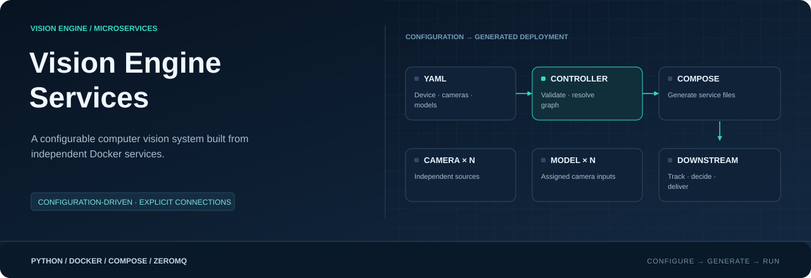
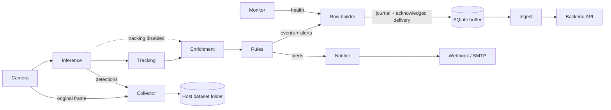

<div align="center">



**Configuration-driven vision microservices · Generated Docker deployment**

[](https://www.python.org/)
[](https://docs.docker.com/)
[](docs/DEPLOYMENT.md)
[](services/inference/README.md)
[](docs/ARCHITECTURE.md)
[](services/buffer/README.md)

[Getting started](#get-a-device-running) · [Usage](docs/USAGE.md) · [Architecture](docs/ARCHITECTURE.md) · [Configuration](config/README.md) · [Operator handbook](docs/README.md)

</div>

---

## One pipeline. Independent services.

Vision Engine Services turns camera frames into detections, tracks, enriched events,
rule decisions and database rows. Docker packages each service; the configuration
controller creates its instances and connections from your installation YAMLs.
This repository runs independently of Vision Engine Edge.

| Capability | Implementation |
|---|---|
| Capture and reconnect | OpenCV camera service, one instance per enabled camera |
| Detect and track | Shared Ultralytics models; isolated BoxMOT tracking per camera |
| Enrich and decide | Geometry/context enrichment, zone matching, UTC schedules and rule cooldowns |
| Deliver and retain | SQLite buffer, acknowledged local delivery and HTTP ingest |
| Notify and collect | Webhook/SMTP channels; original images with separate YOLO labels |
| Observe | Stage-based logs, health snapshots and device monitoring |



Live stages use bounded queues and best-effort PUB/SUB. Durable delivery begins
at the row builder's persistent delivery journal. Backend HTTP retries remain
at least once. [Read the delivery boundaries](docs/ARCHITECTURE.md#delivery-boundaries).

## Get a device running

**Prerequisites:** Python 3.12, Docker Engine/Desktop, and Docker Compose with
`include` support (v2.20.0 or newer). Run commands from this repository's root.
Container architecture, drivers and model runtimes must match the target device.
The reference inference/tracking images use CPU Torch; Jetson acceleration needs
a compatible image and GPU runtime. Follow the [GPU deployment guide](docs/GPU_DEPLOYMENT.md)
to discover compatible images, verify the model and configure persistent device overrides.

### 1 · Prepare configuration

```console
python -m venv .venv
```

Activate `.venv` for your shell, then install the controller:

```console
python -m pip install -r config/controller/requirements.txt
```

Copy `config/config_sample/*.sample.yaml` into `config/YAMLs/`, removing `.sample`
from each filename. Fill in real sources, camera/model assignments, local weights,
device settings and backend/channel credentials. Samples illustrate options and
contain placeholders; reconcile their cross-file references before generating.
[Copy commands and field ownership →](config/README.md#prepare-installation-files)

### 2 · Validate and generate

```console
python -m config.controller --details
python -m config.controller --generate
```

This writes `pipeline.yaml`, `<service>.compose.yaml` files and the umbrella
`pipeline.compose.yaml` under `config/.generated/`. Generation does not run Docker.

### 3 · Build and run

```console
docker compose -f config/.generated/pipeline.compose.yaml config --services
docker compose -f config/.generated/pipeline.compose.yaml up --build -d --remove-orphans
docker compose -f config/.generated/pipeline.compose.yaml ps
docker compose -f config/.generated/pipeline.compose.yaml logs -f --tail 20 --no-log-prefix
```

Starting ingest contacts the configured backend. Enabled notifier channels can
send real webhooks and email. Review your installation values before starting.

```console
docker compose -f config/.generated/pipeline.compose.yaml stop
```

## Linux operator menu

Use the menu to generate configuration, build/deploy all or one service, view
logs/status, diagnose the device and enable Docker at boot:

```bash
bash scripts/service.sh
```

Direct commands include `bash scripts/service.sh deploy` and
`bash scripts/service.sh diagnose`. Deployment recreates selected containers;
persistent data is preserved. [Commands and behavior](docs/OPERATOR.md)

## Navigate the project

| Location | What belongs here |
|---|---|
| [config/](config/README.md) | Samples, installation YAMLs and the local controller |
| [services/](services/README.md) | Eleven independent service implementations |
| [docs/](docs/README.md) | Architecture and practical operating guides |
| `config/.generated/` | Recreated local pipeline and deployment artifacts |
| `models/` | Locally supplied model assets |
| `collected/` | Default persistent dataset output on the host |
| `data/` | Native-run databases/journals/reports; Docker uses named volumes |

Source, Dockerfiles, documentation and samples belong in Git. Installation YAMLs,
credentials, generated files, model weights, datasets, databases and virtual
environments stay local. Installation/model folders and local `collected/` and `data/` folders
use `.gitkeep` so they exist after cloning; their runtime contents stay ignored.

## Keep code and data separate

> [!IMPORTANT]
> The Compose project is `visionengine-<device.environment>-edge`. Changing the
> environment changes Docker's default volume namespace. Existing buffered rows
> do not automatically move into the new project. [Naming and migration →](docs/NAMING.md)

Code-only changes need a rebuild of the affected image and recreation of its
containers, not a rebuild of every image. Named volumes and host dataset mounts
survive normal recreation. [Selective updates →](docs/UPDATES.md) ·
[Where data lives →](docs/STORAGE.md)

## Deployment scope

The generator currently targets one local Compose deployment. Services accept
explicit TCP endpoints, but automatic multi-device partitioning and remote
monitor telemetry are not implemented. Raw ZeroMQ frames are not RTSP/WebRTC;
a browser streaming gateway remains a future service. Hardware throughput must
be measured with the actual cameras, models and board.
