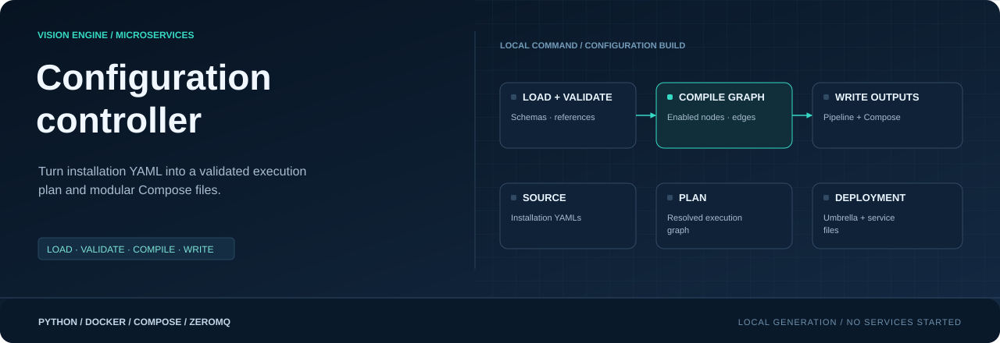
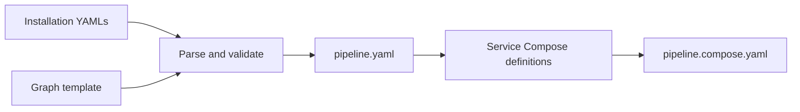

<div align="center">



**Installation intent → validated graph → executable deployment**

[](controller/requirements.txt)
[](config_sample/)
[](../docs/DEPLOYMENT.md)

[Project](../README.md) · [Handbook](../docs/README.md) · [Naming](../docs/NAMING.md)

</div>

## What this directory owns

The controller is a local Python command. It loads installation files, parses
sections, validates references, resolves the graph and writes generated artifacts.
It does not start services, open cameras, download weights or run Docker.
Services reuse parser code from this independent project, without parent imports.

```text
config/
├── config_sample/        Versioned *.sample.yaml templates
├── YAMLs/                Actual installation values; ignored except .gitkeep
├── controller/
│   ├── parsers/          Per-section and graph schemas
│   ├── registry.py       Section names, filenames and parser registration
│   ├── loader.py         YAML loading
│   ├── validation.py     Cross-file checks
│   ├── compiler.py       Graph expansion and connection validation
│   ├── deployment.py     Containers, endpoints, mounts and Compose grouping
│   ├── writer.py         Atomic YAML writes and formatting
│   ├── __main__.py       CLI and generation orchestration
│   └── requirements.txt
└── .generated/           Local generated artifacts; ignored by Git
```

## Prepare installation files

Use Python 3.12 from the repository root. The controller dependency is PyYAML;
OpenCV, Torch, Ultralytics and BoxMOT are not required just to process configuration.

```console
python -m pip install -r config/controller/requirements.txt
```

PowerShell, preserving existing installation files:

```powershell
New-Item -ItemType Directory -Path config/YAMLs -Force | Out-Null
Get-ChildItem config/config_sample -Filter "*.sample.yaml" | ForEach-Object {
    $destination = Join-Path "config/YAMLs" ($_.Name.Replace(".sample", ""))
    if (-not (Test-Path -LiteralPath $destination)) {
        Copy-Item -LiteralPath $_.FullName -Destination $destination
    }
}
```

Linux/macOS shell:

```bash
mkdir -p config/YAMLs
for source in config/config_sample/*.sample.yaml; do
    name="$(basename "$source" .sample.yaml).yaml"
    if [ ! -e "config/YAMLs/$name" ]; then
        cp "$source" "config/YAMLs/$name"
    fi
done
```

Supply actual values and reconcile references. The samples illustrate independent
options; they are not a ready-to-run site deployment. Do not commit credentials,
camera URLs, local YAMLs or generated files. Models are supplied separately.

## Configuration ownership

| File | Owns |
|---|---|
| [device.yaml sample](config_sample/device.sample.yaml) | Device identity, environment, camera limit, logs and heartbeat/report settings |
| [api.yaml sample](config_sample/api.sample.yaml) | Backend identity/auth, URL, ingest batches/retries and buffer storage |
| [cameras.yaml sample](config_sample/cameras.sample.yaml) | Camera IDs/sources, enabled state, target FPS, model/classes, zones and table routing |
| [models.yaml sample](config_sample/models.sample.yaml) | Model assets, runtime/device, thresholds, input size and tracking choice |
| [rules.yaml sample](config_sample/rules.sample.yaml) | Matching, UTC schedules, cooldowns, severity/messages and notification tables |
| [notifications.yaml sample](config_sample/notifications.sample.yaml) | Log, webhook and SMTP channels with rule/severity filters |
| [collection.yaml sample](config_sample/collection.sample.yaml) | Output directory, sessions, UTC schedules, sampling, filters and sample limits |
| [boxmot_tracker.yaml sample](config_sample/boxmot_tracker.sample.yaml) | Algorithm parameters and optional ReID/backend settings |
| [graph.yaml sample](config_sample/graph.sample.yaml) | Node templates, typed ports, edges, conditions and queue profiles |

Eight application sections are registered; `graph.yaml` is additionally loaded
for planning/generation. A service does not always need its own YAML: enrichment,
monitor and row builder reuse context from these files.

## Commands

| Command | Result |
|---|---|
| `python -m config.controller` | Validate registered files and cross-file references |
| `python -m config.controller --details` | Also explain resolved camera/model settings |
| `python -m config.controller --plan` | Print the resolved pipeline YAML without writing |
| `python -m config.controller --generate` | Write pipeline, service Compose files and umbrella |
| `python -m config.controller --config PATH` | Read a different installation directory |
| `python -m config.controller --config config/config_sample --samples` | Read sample filenames; placeholders may fail validation |

`--graph FILE` selects a graph template. `--output FILE` changes pipeline output.
`--compose-output FILE` changes the umbrella destination; service Compose files
are written beside it. Run `python -m config.controller --help` for CLI help.
The default input is already `config/YAMLs`; repeated `--config config` is not
needed. All configuration schedule times use UTC; there is no collection timezone
setting. Rules use current UTC evaluation time; collector uses frame capture time.

## Graph, pipeline and Compose



`graph.yaml` declares node templates, typed inputs/outputs, allowed branches and
conditions. The compiler expands cameras, models and sessions, removes inactive
branches, and resolves edges with camera selections and queue policies.
`pipeline.yaml` records the actual plan; absent nodes will not be deployed.
Supported runtime builders turn that plan into executable containers. Any planned
but unsupported stage is reported through `omitted_nodes`.

Common paths are camera → inference → tracking → enrichment → rules, with
inference → enrichment when tracking is disabled. Collectors use direct camera
frames plus direct inference detections. Rules feed accepted events/alerts to
row builder and alerts to notifier. Monitor feeds health to row builder; durable
row delivery runs through buffer and ingest.

## Generated artifacts

```text
config/.generated/
├── pipeline.yaml
├── pipeline.compose.yaml
├── camera.compose.yaml
├── inference.compose.yaml
├── tracking.compose.yaml
├── enrichment.compose.yaml
├── rules.compose.yaml
├── row_builder.compose.yaml
├── buffer.compose.yaml
├── ingest.compose.yaml
├── notifier.compose.yaml
├── monitor.compose.yaml
└── collector.compose.yaml
```

Only active deployed service types are included. The umbrella contains:

| Section | Meaning |
|---|---|
| `name` | `visionengine-<device.environment>-edge` |
| `x-visionengine` | Revision, stage summary, omitted nodes and endpoint maps; descriptive metadata |
| `volumes` | Shared persistent/runtime volumes used by included services |
| `include` | Service Compose files loaded as one deployment |

Each service file contains image/build settings, commands, host ports, mounts,
restart behavior and health settings. Actual connections are CLI arguments, not
instructions interpreted from `x-visionengine`. The images use
`visionengine-<service>:local`; Compose instances use the agreed
`visionengine-<service>-service[-<instance>]` scheme. [Full naming guide](../docs/NAMING.md)

Generation preserves source YAMLs. The writer compares formatted bytes and leaves
unchanged files untouched; changed YAML files are replaced atomically. This is
per-file atomic replacement, not a transactional swap of the entire output set.
Generated outputs remain machine-owned and should stay together.

## Validate and reject

Unknown keys/types, duplicate IDs, missing camera/model references, invalid
classes/rules, inconsistent graph contracts and unsupported deployment policies
are rejected with file/field context and a nonzero exit. Model asset availability,
source connectivity, actual hardware speed and Docker startup are runtime checks.
A blank `collection.yaml` or an empty session list disables collection.

Collector requires `save.raw: true` and `save.annotated: false`; YOLO labels are
always written. `save.metadata` controls optional JSON sidecars. Frames/results
must match exactly before storage. Enabled SMTP channels use named password
environment variables; generated Compose includes references, never literal
password values. The variables must be set when Docker reads the files.

> [!IMPORTANT]
> Changing `device.environment` changes the default volume namespace. Existing
> buffers/journals are not migrated automatically. [Naming](../docs/NAMING.md) ·
> [Storage](../docs/STORAGE.md)

## Apply the result

```console
python -m config.controller --generate
docker compose -f config/.generated/pipeline.compose.yaml config --services
docker compose -f config/.generated/pipeline.compose.yaml up --build -d --remove-orphans
```

Generation never starts containers. Services load mounted YAML at startup;
a YAML-only edit can require explicit process recreation even if the generated
Compose definition did not change. [Update guide](../docs/UPDATES.md)

For a new configuration section, add its parser, registry entry, samples and
cross-file checks; connect compiler/deployment behavior only where needed.
[Extension guide](../docs/EXTENDING.md)
