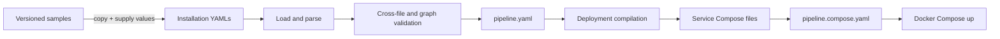

# Architecture and service boundaries

[Handbook](README.md) / Architecture

## Configuration becomes a deployment

The controller runs locally when invoked. It does not stay alive, watch cameras,
download model weights or start Docker. It expands enabled instances and graph
conditions into a resolved plan. Docker then starts the declared processes.
Each image includes its service implementation and configuration parser; services
do not import the parent Edge project or each other's Python implementations.

## Processing and side branches

| Service | Scope | Responsibility |
|---|---|---|
| Camera | Enabled camera | Decode and publish original BGR frames; reconnect source |
| Inference | Used model | Share one loaded model across selected cameras; publish detections and annotations |
| Tracking | Tracked camera | Maintain camera-specific BoxMOT state and track UUIDs |
| Enrichment | Camera | Add geometry, anchor coordinates and camera/model context |
| Rules | Shared | Assign zones; apply filters, UTC schedules and cooldowns |
| Row builder | Shared | Map accepted events, alerts and health to database rows |
| Buffer | Shared | Own SQLite, receipts, pending rows and leases |
| Ingest | Shared | POST table batches to backend and acknowledge confirmed rows |
| Notifier | Shared when configured | Deliver fired alerts to logs, webhooks and SMTP |
| Monitor | Device | Aggregate shared health snapshots and publish device metadata |
| Collector | Enabled collection session | Match original frames with direct inference results; save YOLO datasets |

Tracking-disabled cameras connect inference directly to enrichment. Collectors
always consume camera originals and direct inference detections, independently
of tracker confirmation. Monitor feeds health to row builder; it never builds
its own database rows. Alert delivery and notification table storage are separate.

## Ports and contracts

Host ports shown are starting values; subsequent camera/model/session instances
increment them. Actual mappings appear in `x-visionengine` in the umbrella file.

| Publisher | Output | Container port | Host start |
|---|---|---|---|
| Camera | `frame.v1` | 5555 | 5555 |
| Inference | `detections.v1` | 5556 | 6000 |
| Inference | Annotated `frame.v1` | 5557 | 7000 |
| Tracking | Tracked `detections.v1` | 5558 | 8000 |
| Enrichment | `event.v1` | 5559 | 9000 |
| Rules | Accepted `event.v1` | 5560 | 10000 |
| Rules | `alert.v1` | 5561 | 11000 |
| Row builder | Observational `rows.v1` | 5562 | 12000 |
| Monitor | `health.v1` | 5563 | 13000 |
| Buffer | Request/reply protocol | 5564 | 14000 |
| Buffer | `buffer.status.v1` | 5565 | 15000 |
| Ingest | `ingest.status.v1` | 5566 | 16000 |
| Notifier | `notifier.status.v1` | 5567 | 17000 |
| Collector | `collector.status.v1` | 5568 | 18000 |

Frames use three multipart parts: topic, JSON header, raw contiguous BGR pixels.
Most metadata streams use topic and JSON. Buffer is a correlated REQ/REP protocol,
not a subscription stream. Camera/stream/sequence identify a frame across stages;
matching pixels and detections additionally checks timestamp and dimensions.
Raw 960 × 480 BGR is 1,382,400 bytes per frame before transport overhead.

## Queues and instance scaling

Queues have item, byte and local-age limits. Live inference favors recent frames
with bounded drop-oldest input queues and fair camera scheduling. Dropped source
frames do not become synthetic tracker updates. Different stages have different
limits; the graph profiles and generated command arguments are the authority.

A shared model shares compute time, not just memory. If inference cannot sustain
combined camera input, more queue space cannot create compute capacity. Naively
replicating PUB/SUB subscribers duplicates work rather than distributing it.
Explicit camera assignment, resource capacity and ordered tracker inputs must be
considered together. Automatic replica load balancing is not implemented.

## Delivery boundaries

| Boundary | Guarantee and practical limit |
|---|---|
| Camera through rules | Live PUB/SUB, finite queues, no replay or delivery acknowledgement |
| Rules to notifier | Live best effort; per-channel queues, no persistent retry |
| Row-builder input | Still live; loss can happen before a row is journaled |
| Row-builder journal to buffer | Persisted batch IDs and acknowledged transactional retry; bounded receipt retention |
| Buffer to ingest | Leased claims, renewal, release and acknowledged completion |
| Ingest to backend | At-least-once HTTP semantics; uncertain responses/crashes can duplicate inserts |
| Collector files | Journaled recoverable saves; filesystem/hardware durability still matters |

An observed publisher counter is a local send count, not proof of downstream
receipt. A full durable producer journal blocks row building; upstream live queues
can still overflow. Buffer capacity handling can drop old pending rows and exposes
that loss. [Persistence details](STORAGE.md)

## Deployment scope

Containers communicate by service DNS on one Compose network. Host published ports
bind to localhost by default. Across hosts, explicit reachable endpoints and
private/secure routing are required. Automatic per-host graph partitioning,
remote health telemetry and frontend RTSP/WebRTC encoding remain extension work.
A Docker image does not remove architecture, driver or accelerator constraints.
