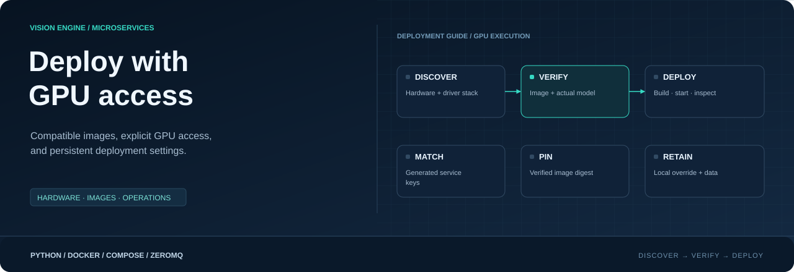
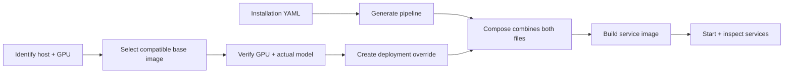

<div align="center">



**Discover the hardware. Verify the image. Deploy with persistent device settings.**

[](https://docs.docker.com/compose/how-tos/gpu-support/)
[](../services/inference/README.md)
[](#6--create-the-device-deployment-override)

[Handbook](README.md) · [Deployment](DEPLOYMENT.md) · [Operator menu](OPERATOR.md) · [Inference](../services/inference/README.md)

</div>

## What this guide configures

Vision Engine Services separates the model configuration, generated pipeline and
hardware deployment settings. GPU deployment requires all three to agree with the
host and model asset. A container packages dependencies; it does not make every
model portable across architectures, GPU families or runtime versions.

| Layer | Responsibility | Where you configure it |
|---|---|---|
| Host | Physical GPU, driver and container integration | Device OS and Docker/NVIDIA tooling |
| Base image | Compatible Python, Torch and model runtime libraries | Verified vendor image selected for the target platform |
| Model | Asset, execution backend and requested accelerator | `config/YAMLs/models.yaml` |
| Pipeline | Instances, connections, mounts and service names | Generated `config/.generated/` files |
| Deployment override | Image build arguments and container hardware access | Local `config/deployment.compose.yaml` |
| Operator script | Apply the generated pipeline and optional override together | `bash scripts/service.sh` |



The commands below target Linux and NVIDIA GPU deployments. Jetson and standard
NVIDIA Linux hosts have separate selection paths. CPU deployments can omit the
override. Apple MPS/CoreML and Hailo are not enabled by these NVIDIA settings;
Hailo inference is not implemented in this service.

> [!NOTE]
> Run project commands from your repository root. Replace every `REPLACE_...`
> value before executing an example. Service names, image references, model paths,
> dimensions and device indices belong to your installation. No model name or
> container count is required by this guide.

## 1 · Identify the host and container integration

```bash
uname -m
cat /etc/os-release
sudo docker version
sudo docker compose version
sudo docker info --format 'Available runtimes: {{json .Runtimes}}'
```

`aarch64` normally corresponds to Docker `linux/arm64`; `x86_64` corresponds to
`linux/amd64`. The image must support the host architecture and GPU software stack.
Use a Compose release supporting the generated `include` files; this guide uses
v2.20.3 or later as its baseline.

**On Jetson**, also inspect the installed Jetson Linux release:

```bash
cat /etc/nv_tegra_release
```

Use that release and NVIDIA's compatibility documentation to identify the
appropriate JetPack/image family. ARM64 alone is insufficient: an ARM64 server
image is not automatically compatible with Jetson.

**On a standard NVIDIA Linux GPU host**, inspect the driver and available GPUs:

```bash
nvidia-smi
```

The CUDA version shown by `nvidia-smi` describes driver compatibility, not the
version of Torch or every installed CUDA toolkit. Jetson may use `tegrastats`
instead; missing `nvidia-smi` is not by itself proof of a missing Jetson GPU.

If NVIDIA container integration is missing, follow the platform's official setup
instructions before continuing. This project script does not install GPU drivers
or the NVIDIA Container Toolkit, and does not need Docker's global default runtime
changed when GPU access is configured explicitly for the service.

See [NVIDIA Container Toolkit installation](https://docs.nvidia.com/datacenter/cloud-native/container-toolkit/latest/install-guide.html)
and the [Ultralytics Jetson guide](https://docs.ultralytics.com/guides/nvidia-jetson/).

### Optional: inspect an existing working environment

If a model already works in a native Python environment, record its package
versions using that environment's Python executable:

```bash
/path/to/working/environment/bin/python -c 'import torch, tensorrt; print("PyTorch:", torch.__version__); print("Torch CUDA build:", torch.version.cuda); print("TensorRT:", tensorrt.__version__); print("GPU available:", torch.cuda.is_available())'
```

TensorRT is only required for the backends that use it. For a Torch-only model,
omit its import and version print. A working native environment is useful evidence
for selecting a container; it is not a prerequisite for a new installation.

## 2 · Obtain a compatible base image

Choose an image from the model/framework vendor's documented deployment options.
Check architecture, host driver requirements, supported JetPack release where
applicable, Python version, Torch/torchvision compatibility and model backend.
A CUDA-only image may still lack Torch, Ultralytics or TensorRT.

| Target | Selection starting point |
|---|---|
| Jetson | Vendor image explicitly supporting the installed JetPack/Jetson Linux family; see [Ultralytics Jetson images](https://docs.ultralytics.com/guides/nvidia-jetson/) |
| NVIDIA Linux GPU workstation/server | Vendor CUDA-enabled framework image matching the host architecture and driver requirements; see [Ultralytics Docker images](https://docs.ultralytics.com/guides/docker-quickstart/) |
| CPU | Existing reference Dockerfile, or a deliberately selected compatible CPU base |

For example, `ultralytics/ultralytics:latest-jetson-jetpack6` is a JetPack 6 image
family. It is not a universal Jetson or NVIDIA image. Select the family from the
vendor's current documentation, then verify the downloaded image itself.

```bash
GPU_BASE_TAG='REPLACE_WITH_VENDOR_REPOSITORY:COMPATIBLE_TAG'
sudo docker pull "$GPU_BASE_TAG"
sudo docker image inspect "$GPU_BASE_TAG" \
  --format 'Platform: {{.Os}}/{{.Architecture}}; Digests: {{json .RepoDigests}}'
```

Copy the appropriate `repository@sha256:...` reference from `RepoDigests` into:

```bash
GPU_BASE_IMAGE='REPLACE_WITH_REPOSITORY@sha256:VERIFIED_DIGEST'
```

Use this digest for the checks below and the final override. Tags such as `latest`
can change; a digest identifies the downloaded image content. A digest pins the
base, not every later dependency: service requirements currently contain version
ranges, so record and review the resulting service image as well.

### What is supplied by the image?

The GPU-enabled base supplies compatible user-space packages. The NVIDIA container
integration exposes GPU devices and required host driver components. **Do not copy
the host CUDA directory into the container as a deployment procedure.** Granting
GPU access neither installs missing Python packages nor reserves a private GPU.
Multiple applications can share the physical GPU and compete for its resources.
See [NVIDIA runtime configuration](https://docs.nvidia.com/datacenter/cloud-native/container-toolkit/latest/docker-specialized.html).

The current service Dockerfile uses `apt-get`, `python` and `python -m pip`.
Choose a compatible Debian/Ubuntu-style base with these commands and a Python
version that can execute the service and its dependencies. An arbitrary vendor
image may require a separate Dockerfile adaptation.

## 3 · Verify GPU access inside the candidate image

For Jetson using the registered NVIDIA runtime:

```bash
sudo docker run --rm --runtime=nvidia \
  -e NVIDIA_VISIBLE_DEVICES=all \
  -e NVIDIA_DRIVER_CAPABILITIES=compute,utility \
  --entrypoint python "$GPU_BASE_IMAGE" \
  -c 'import torch; print("PyTorch:", torch.__version__); print("Torch CUDA build:", torch.version.cuda); print("GPU available:", torch.cuda.is_available()); assert torch.cuda.is_available(), "CUDA is unavailable"; print("GPU:", torch.cuda.get_device_name(0))'
```

On a standard NVIDIA Linux host configured for Docker GPU device requests, use
`--gpus all` in place of `--runtime=nvidia` for this check. Follow the platform's
supported GPU access method; do not assume the methods are interchangeable on
every Jetson/toolkit release.

For a TensorRT model, check that package separately:

```bash
sudo docker run --rm --runtime=nvidia \
  -e NVIDIA_VISIBLE_DEVICES=all \
  -e NVIDIA_DRIVER_CAPABILITIES=compute,utility \
  --entrypoint python "$GPU_BASE_IMAGE" \
  -c 'import tensorrt; print("TensorRT:", tensorrt.__version__)'
```

Use the same platform-appropriate GPU flag in subsequent examples. These commands
start temporary containers that exit and remove themselves. They do not start the
Vision Engine pipeline. If the base only provides `python3`, check its packaging
and provide a suitable `python` command before using the existing service Dockerfile.

## 4 · Verify the actual model asset

Place the required asset under the repository's `models/` directory. Copying an
asset from another installation leaves the original untouched; confirm its license,
architecture/backend compatibility and any external companion files. The service
does not automatically download missing model assets.

TensorRT `.engine` compatibility depends on how the engine was exported, its
TensorRT version and target hardware. Matching package version strings alone is
not proof that an engine will load. Re-export on a supported target if necessary;
see [NVIDIA engine compatibility](https://docs.nvidia.com/deeplearning/tensorrt/latest/inference-library/engine-compatibility.html).

For a single-file Ultralytics detection model, set these installation values:

```bash
MODEL_FILE='REPLACE_WITH_MODEL_FILENAME.engine'
MODEL_WIDTH=640
MODEL_HEIGHT=640
GPU_DEVICE=0
```

Replace the example dimensions with the model's supported input dimensions. Test
one blank BGR frame through the real model backend:

```bash
sudo docker run --rm --runtime=nvidia \
  -e NVIDIA_VISIBLE_DEVICES=all \
  -e NVIDIA_DRIVER_CAPABILITIES=compute,utility \
  -e YOLO_AUTOINSTALL=False \
  --mount "type=bind,source=$PWD/models,target=/models,readonly" \
  --entrypoint python "$GPU_BASE_IMAGE" \
  -c 'import sys, numpy as np; from ultralytics import YOLO; path, width, height, device = sys.argv[1:]; model = YOLO(path, task="detect"); model.predict(np.zeros((int(height), int(width), 3), dtype=np.uint8), device=int(device), imgsz=(int(height), int(width)), save=False); print("Model inference completed")' \
  "/models/$MODEL_FILE" "$MODEL_WIDTH" "$MODEL_HEIGHT" "$GPU_DEVICE"
```

Success proves that this model/backend can execute inside this candidate image.
It does not measure sustained throughput or validate real-camera decoding,
detection accuracy, tracking or backend delivery. An engine portability warning
still deserves investigation and testing with representative scenes.

In `config/YAMLs/models.yaml`, select `runtime: ultralytics` and the appropriate
`accelerator`, such as `cuda` or `cuda:0`. TensorRT is an Ultralytics backend here,
selected by the model asset; `runtime: tensorrt` is not a supported configuration.
For `.engine` files, precision is fixed at export: `half` does not convert them.

## 5 · Discover the generated service names

Prepare coherent installation YAML files, then generate using the operator script:

```bash
bash scripts/service.sh generate
sudo docker compose -f config/.generated/pipeline.compose.yaml config --services
```

Generation validates configuration and writes the deployment; it does not start
containers or verify GPU/model availability. Identify the inference service names
from this list and `config/.generated/inference.compose.yaml`. The node `command`
contains `--model-id`, which links each service to its model configuration.

Use the **Compose service key**, not the image name, logical graph node ID or full
running container name. Naming typically follows
`visionengine-inference-service-<normalized-model-id>`; always use the generated
result because IDs can be normalized. Disabled/unused models may have no service.
See [naming](NAMING.md) and [configuration](../config/README.md).

## 6 · Create the device deployment override

Create `config/deployment.compose.yaml` in your checkout. This is a persistent,
installation-specific file. Compatible devices can share the same settings; it is
not required to be unique per physical board. The controller does not generate or
auto-detect its contents.

The following is a **template**, not a runnable configuration. Replace both values:

```yaml
services:
  REPLACE_WITH_GENERATED_INFERENCE_SERVICE_KEY:
    # Keep the generated context and Dockerfile; customize their build arguments.
    build:
      args:
        BASE_IMAGE: "REPLACE_WITH_VERIFIED_REPOSITORY@sha256:DIGEST"
        INSTALL_TORCH: "0"

    # NVIDIA runtime access, commonly used on Jetson.
    runtime: nvidia
    environment:
      NVIDIA_VISIBLE_DEVICES: all
      NVIDIA_DRIVER_CAPABILITIES: compute,utility
```

| Setting | Meaning |
|---|---|
| Service key | Existing generated inference service to customize |
| `BASE_IMAGE` | Exact compatible base verified above; used by the Dockerfile's `FROM` |
| `INSTALL_TORCH: "0"` | Skip the Dockerfile's separate Torch install when the base already supplies compatible Torch/torchvision |
| `runtime: nvidia` | Select the installed NVIDIA container runtime |
| `NVIDIA_VISIBLE_DEVICES` | GPU visibility; choose the devices supported by your platform |
| `NVIDIA_DRIVER_CAPABILITIES` | Expose compute/utility capabilities; display rendering is not needed for ordinary inference |

Service dependencies are still installed during the build. `INSTALL_TORCH=0` does
not freeze packages or guarantee that dependency resolution cannot alter them;
inspect the final service image before deployment. If the base lacks required
Torch packages, skipping their installation is incorrect.

For standard NVIDIA Linux hosts, an alternative to the `runtime: nvidia` block is
Docker's GPU reservation configuration, while retaining the build arguments and
appropriate environment settings:

```yaml
    deploy:
      resources:
        reservations:
          devices:
            - driver: nvidia
              count: 1
              capabilities: [gpu]
```

Select this access method only for a supported host/toolkit setup. `count: 1` grants
access; it does not provide exclusive use or partition GPU memory. For explicit
GPU selection, use `device_ids` instead of `count`; do not specify both. See
[Docker GPU access](https://docs.docker.com/compose/how-tos/gpu-support/).

### Multiple model services

Add one override entry for every generated service that requires customization:

```yaml
services:
  REPLACE_WITH_FIRST_INFERENCE_SERVICE_KEY:
    build:
      args:
        BASE_IMAGE: "REPLACE_WITH_VERIFIED_REPOSITORY@sha256:DIGEST"
        INSTALL_TORCH: "0"
    runtime: nvidia
    environment:
      NVIDIA_VISIBLE_DEVICES: all
      NVIDIA_DRIVER_CAPABILITIES: compute,utility

  REPLACE_WITH_SECOND_INFERENCE_SERVICE_KEY:
    build:
      args:
        BASE_IMAGE: "REPLACE_WITH_VERIFIED_REPOSITORY@sha256:DIGEST"
        INSTALL_TORCH: "0"
    runtime: nvidia
    environment:
      NVIDIA_VISIBLE_DEVICES: all
      NVIDIA_DRIVER_CAPABILITIES: compute,utility
```

Generated inference services normally share `visionengine-inference:local`. Keep
their build arguments consistent when sharing that tag. If two services need
different bases/builds, give each override a distinct `image:` tag as well, so
one build cannot replace the image intended for another service. GPU indices in
model configuration refer to the device numbering visible inside that container.

### Tracking and other services

Only grant GPU access to stages that need it. The current detection-only ByteTrack
path uses CPU association; it does not need the inference GPU base. A tracker
using a neural ReID model may need its own compatible image and GPU configuration.
The tracking Dockerfile also exposes `BASE_IMAGE`, `INSTALL_TORCH` and
`TORCH_INDEX_URL`, but verify the selected algorithm and its dependencies before
applying overrides. This file customizes existing services; it does not implement
new hardware adapters, distribute cameras across workers or provision remote hosts.

## 7 · Validate the combined deployment

```bash
sudo docker compose \
  -f config/.generated/pipeline.compose.yaml \
  -f config/deployment.compose.yaml \
  config --quiet && echo "Combined Compose valid"
```

Docker combines both files in memory; it does not rewrite the generated file or
create a second inference instance. The later override adds/replaces matching
settings while preserving generated commands, inputs, ports and mounts. Docker
supports a global override over included Compose models; see
[include overrides](https://docs.docker.com/compose/how-tos/multiple-compose-files/include/#using-overrides-with-included-compose-files).

The existing `compose()` helper in `scripts/service.sh` loads the optional override
when it exists. This applies to build, deploy, start, stop, status, logs and other
operations routed through that helper. Without the file, the generated deployment
is used alone. Direct Docker commands do not inherit this script behavior: supply
both `-f` arguments yourself whenever operating this customized deployment.

Use `config --quiet` for routine validation. Full `config` output can include
resolved installation settings/secrets; review it locally before sharing.

## 8 · Build, inspect and start

```bash
bash scripts/service.sh
```

| Menu action | Purpose |
|---|---|
| **1 · Validate + generate** | Resolve installation YAML into pipeline/Compose; leave the override intact |
| **3 · Build images only** | Build images with the merged deployment settings; start no containers |
| **4 · Start existing images** | Start/reconcile the deployment using built images |
| **7 · Container status** | Inspect container state and health |
| **8 · Live service logs** | Inspect input/process/output activity |
| **9 · Diagnostics** | Check host, configuration and deployment without changing them |
| **11 · Performance report** | Inspect resource, sensor and health snapshots |
| **5 · Stop containers** | Stop the deployment while preserving stored data |

After the build, discover the final image reference for the chosen service from
the generated service file plus any `image:` override. Verify it before starting:

```bash
SERVICE_IMAGE='REPLACE_WITH_FINAL_SERVICE_IMAGE:TAG'
sudo docker run --rm --runtime=nvidia \
  -e NVIDIA_VISIBLE_DEVICES=all \
  -e NVIDIA_DRIVER_CAPABILITIES=compute,utility \
  --entrypoint python "$SERVICE_IMAGE" \
  -c 'import torch, ultralytics; print("Torch:", torch.__version__); print("Torch CUDA build:", torch.version.cuda); print("Ultralytics:", ultralytics.__version__); assert torch.cuda.is_available(), "CUDA is unavailable"; print("GPU:", torch.cuda.get_device_name(0))'
```

Use the platform-appropriate GPU flag again. Check TensorRT and repeat the model
check with the final service image when using an engine, since installing service
dependencies may have changed the base environment. `pip check` in the final image
can also identify unresolved package dependency conflicts; it does not prove
runtime GPU compatibility.

Starting all services activates configured cameras, ingest and notifier channels.
Check the destination configuration before an initial cutover. During migration,
stop the previous deployment deliberately to avoid two pipelines delivering the
same events; preserve its code/assets and pending data for rollback. Do not copy
an older installation's SQLite buffer into the new buffer without verifying its
schema and delivery semantics. See [storage](STORAGE.md).

Healthy containers prove their health checks passed, not detection accuracy,
notification receipt or backend persistence. Verify real detections, stable tracks,
rules, output rows and successful delivery with [observability](OBSERVABILITY.md).
The inference scheduler uses each camera's `fps_target`; a measured rate near that
target does not by itself mean the GPU has reached its hardware limit. Queue drops
are cumulative skipped-frame counts, not empty detections.

## 9 · Regeneration, updates and reboot

| Change | What to do |
|---|---|
| Camera/rule/model settings | Validate and regenerate; apply the changed deployment to affected services |
| Model ID renamed or removed | Reconcile corresponding override keys before validating combined Compose |
| Another used model added | Discover its generated key and add GPU settings if needed |
| Base image updated | Pull, verify packages/GPU/model, pin its new digest, rebuild and recreate affected services |
| GPU environment/mounts changed | Reconcile/recreate containers; a simple restart does not apply new Compose settings |
| Source code updated | Rebuild affected images and recreate every relevant container sharing them |
| Deployment override absent | Script uses generated settings alone, including the reference CPU build defaults |

`config/deployment.compose.yaml` is ignored by the existing Git rules for
installation YAMLs. It is not supplied by a fresh clone and must be provisioned or
restored on each installation. Confirm the ignore rule with:

```bash
git check-ignore config/deployment.compose.yaml
```

Keep a private backup of installation settings. Commit general templates and
procedures as documentation rather than adding local credentials or model assets.
The override survives generation; if it retains a removed service key it can
introduce an unintended extra service or a configuration conflict. Review the
merged service list after model changes, not just YAML syntax.

On systemd Linux, check Docker startup separately from container policies:

```bash
systemctl is-enabled docker.service
bash scripts/service.sh diagnose
```

Menu **10** enables Docker at boot; it does not start stopped containers. Generated
containers use `restart: unless-stopped`: running containers normally resume when
Docker starts, while explicitly stopped containers stay stopped. They appear under
Docker, not as one systemd unit per vision service. A boot-enabled Docker daemon
alone does not prove full recovery; perform a planned reboot check and verify
camera reconnection, model loading and delivery afterward.

Image rebuilds and ordinary container recreation preserve correctly mounted
persistent volumes and host datasets. They do not migrate data across changed
Compose project/volume names. Read [updates](UPDATES.md) and [storage](STORAGE.md)
before changing those identities.

## Troubleshooting map

| Observation | Check next |
|---|---|
| `unknown runtime nvidia` | NVIDIA Container Toolkit registration for the target platform |
| `torch.cuda.is_available()` is false | CPU Torch package, GPU access flags, driver compatibility and selected image architecture |
| Vulkan `nvidia_icd.json` mount/link conflict before Python | Retry compute-only inference with `NVIDIA_DRIVER_CAPABILITIES=compute,utility`; if it persists, inspect toolkit/version guidance rather than deleting driver files |
| Missing `python`, `apt-get` or framework modules | Base image does not meet the current Dockerfile's prerequisites |
| TensorRT engine cannot deserialize | Export/runtime versions, target GPU, engine build flags and model completeness |
| Config validates but service fails | Validation does not load models or prove hardware availability; inspect service logs |
| GPU works in the base but fails in the service | Final installed dependencies, selected final image and merged container GPU settings |
| An override seems ignored | Exact service key, both Compose files loaded, and container recreation after changes |
| Other inference instances behave differently | Shared image tags, inconsistent build arguments and per-container GPU visibility |
| Expected detection or alert is missing | Model classes/confidence, tracking, zones, UTC schedules, cooldown and downstream routing |

Use the [operator guide](OPERATOR.md) for daily controls and
[troubleshooting](TROUBLESHOOTING.md) for broader networking and throughput issues.
