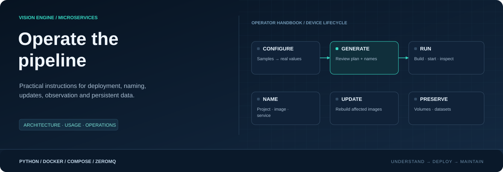

**Configure the system. Generate the deployment. Operate independent services.**

[Project](../README.md) · [Configuration](../config/README.md) · [Service catalog](../services/README.md)

## Choose your starting point

| Your task | Guide |
|---|---|
| Learn the complete configuration → generation → run workflow | [Usage walkthrough](USAGE.md) |
| Understand service boundaries and frame flow | [Architecture](ARCHITECTURE.md) |
| Bring a new device online | [Deployment](DEPLOYMENT.md) |
| Select a GPU image and preserve per-device hardware settings | [GPU deployment](GPU_DEPLOYMENT.md) |
| Use the Linux menu for deploy, logs and diagnostics | [Operator menu](OPERATOR.md) |
| Understand project, image, service and container names | [Naming](NAMING.md) |
| Update one service without rebuilding the entire deployment | [Updates](UPDATES.md) |
| Find datasets, buffer files and persistent volumes | [Storage and recovery](STORAGE.md) |
| Follow logs, inspect outputs and diagnose missing data | [Observability](OBSERVABILITY.md) |
| Resolve startup, networking and throughput problems | [Troubleshooting](TROUBLESHOOTING.md) |
| Add a service or configuration section | [Extension guide](EXTENDING.md) |

## Recommended reading order

[Usage](USAGE.md) → [Naming](NAMING.md) → [Deployment](DEPLOYMENT.md) →
[Observability](OBSERVABILITY.md). Before changing a running system, read
[Updates](UPDATES.md) and [Storage](STORAGE.md).

## Documentation ownership

The root README explains the product and the short startup path. The configuration
README owns fields and generation. Each service README owns its contracts,
processing behavior, files and inspection commands. These guides own cross-service
operations. All commands assume the independent repository root.

Examples use camera `entrance`, model `people`, collection session
`entrance_dataset`, and device ID `node-01`. Substitute your configured IDs;
inspect generated endpoint maps rather than assuming fixed host ports.

> [!NOTE]
> No test directories or benchmark runners are shipped in the current source tree.
> Throughput and hardware compatibility must be checked on the actual device.
> Start with the operational checks in the deployment guide.
