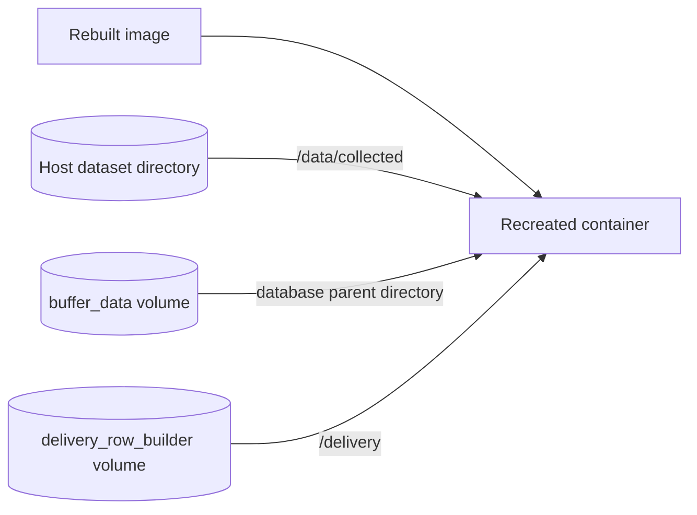

# Storage, persistence and recovery

[Handbook](README.md) / Storage

Images contain software. Host bind mounts and named volumes retain runtime data.
They have separate lifecycles.



## Where output lives

| Data | Host storage | Container location | Owner |
|---|---|---|---|
| Dataset images, labels and journal | `collection.output_dir`, default `./collected` | `/data/collected/<session_id>/` | Collector |
| Pending/sent rows | Named volume `buffer_data` | `api.buffer.path`, commonly `/app/data/buffer.db` | Buffer |
| Unconfirmed producer batches | Named volume `delivery_row_builder` | `/delivery/pending.db` | Row builder |
| Service health snapshots | Named volume `health_snapshots` | `/health/<compose-service>.json` | Services; monitor reads |
| Optional monitor report | Named volume `monitor_reports` when enabled | Generated report path | Monitor |
| Model assets | Configured host file/directory, commonly `models/` | Read-only model mount | Operator |
| Installation YAMLs | `config/YAMLs/` | `/config`, read-only | Operator |
| Terminal logs | Docker logging driver | stdout/stderr | Docker |

Volumes live in Docker-managed storage, not the checkout. On Docker Desktop they
are inside Docker's managed Linux environment. Inspect actual mounts:

```console
docker volume ls
docker volume inspect visionengine-development-edge_buffer_data
docker compose -f config/.generated/pipeline.compose.yaml ps -q visionengine-buffer-service
```

Use the last command's ID with `docker inspect <container-id>`. Volume names are
project-scoped. [Docker volume reference](https://docs.docker.com/reference/compose-file/volumes/)

## Collector: access and export

The default host path is `<checkout>/collected/<session_id>/` on Linux or Windows.
Inside Docker it is `/data/collected/<session_id>/`:

```text
collected/entrance_dataset/
├── data.yaml
├── images/<sample_id>.jpg
├── labels/<sample_id>.txt
├── metadata/<sample_id>.json    # optional
├── .collector.sqlite3          # recovery journal and saved count
├── .collector.lock
├── .pending/
└── .quarantine/
```

One JPEG/TXT pair is one sample. Forty qualifying objects can produce forty label
lines; `max_frames` increases by one. JPEGs contain no drawn boxes. Class IDs follow
configured model class order, recorded in `data.yaml`. Initial train/val entries
both reference `images`; create a real split before training. Labels are model
predictions and need review.

```console
docker compose -f config/.generated/pipeline.compose.yaml exec visionengine-collector-service-entrance-dataset python -m services.collector.tools.inspect --output-dir /data/collected --session-id entrance_dataset --verify
```

The read-only inspector reports journal state and checks hashes with `--verify`.
Edited labels intentionally differ from recorded hashes. Stop collection before
exporting `images/`, `labels/` and `data.yaml`. Preserve the **entire session folder**
including its journal to resume counts/deduplication. A changed camera/class map
requires a new session or explicit migration.

Valid staged saves recover after interruption; invalid partial saves go into
quarantine. Journal state is the committed-count authority: multiple files cannot
be published atomically together. At the cap, the collector remains healthy and
completed. Increase the cap and restart to continue. It does not delete old datasets.
Physical durability depends on storage honoring filesystem flushes.

## Buffer and producer journal

Only buffer opens its SQLite database. Row builder journals each nonempty batch
with a UUIDv4, sequence and SHA-256, then retries until buffer durably commits.
Producer retirement checkpoints allow local source deduplication records to be
deleted without accepting delayed old retries. One checkpoint per producer remains.
Ingest polling, grouping and stable backend delivery UUIDs are unchanged.

`pending` includes leased unsent rows; `inflight` is its leased subset.
Confirmed payloads/completed delivery records are deleted after backend ACK.
Completed ACK replay tokens are bounded to 1024 and expire with their lease.
There is no seven-day receipt/lease/delivery history; `delete_after_hours` is
accepted but no longer retains delivered payloads. Pending rows are never evicted
for capacity. New intake can be rejected while live data fills the buffer.

Schema v3 requires fresh coordinated buffer/journal storage for the development
reset; old data is never automatically deleted. Main database pages are capped,
with intake headroom; physical WAL/SHM bytes can exceed the main-page cap.
A separate bounded maintenance connection reclaims space; SQLite still serializes
writers. Finite storage and upstream queues can still fill during an outage.
[Buffer](../services/buffer/README.md) · [Ingest](../services/ingest/README.md) ·
[Buffer handoff and measurements](BUFFER_HANDOFF.md)

## What survives?

| Operation | Named volumes | Host datasets | Container temporary files |
|---|---|---|---|
| Rebuild image | Preserved | Preserved | Existing container unchanged until recreation |
| Normal recreation | Preserved | Preserved | Replaced |
| `stop` | Preserved | Preserved | Retained with container |
| `down` | Preserved by default | Preserved | Removed with container |
| `down -v` | Removed for project | Not removed by Docker | Removed with container |
| Change environment/project | Old volumes remain; new namespace selected | Same unless path changes | New containers |

## Backup and migration

Stop a SQLite owner before copying its full database directory, or use SQLite's
online backup API. Copying only a live `.db` can miss committed WAL data. Back up
both the producer journal and buffer when preserving the durable boundary. Stop
collector before copying its full session. Protect configuration credentials
separately because Git excludes them.

> [!CAUTION]
> Do not delete volumes, run broad Docker pruning, change environment or replace
> storage paths as routine update steps. Identify mounts and verify backups first.
