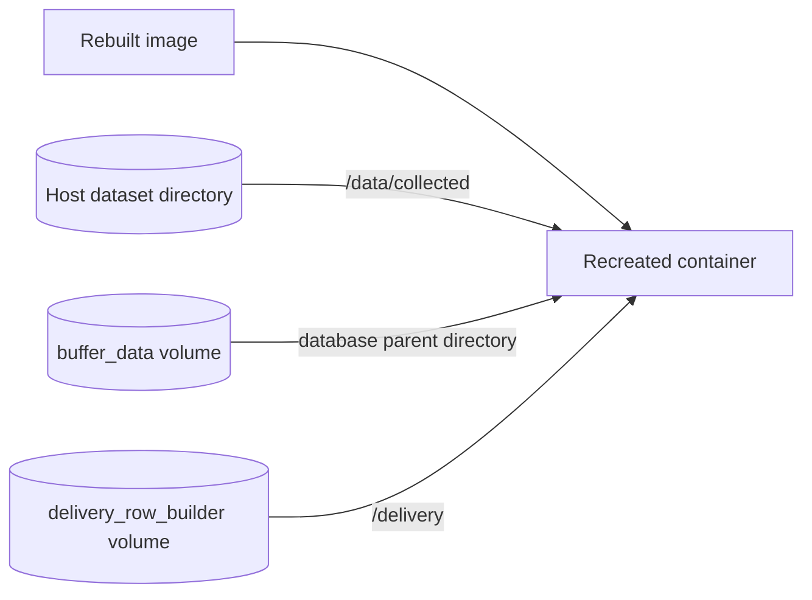

# Storage, persistence and recovery

[Handbook](README.md) / Storage

Images contain software. Host bind mounts and named volumes retain runtime data.
They have separate lifecycles.



## Where output lives

| Data | Host storage | Container location | Owner |
|---|---|---|---|
| Dataset images, labels and journal | `collection.output_dir`, default `./collected` | `/data/collected/<session_id>/` | Collector |
| Pending/sent rows | Named volume `buffer_data` | `api.buffer.path`, commonly `/app/data/buffer.db` | Buffer |
| Unconfirmed producer batches | Named volume `delivery_row_builder` | `/delivery/pending.db` | Row builder |
| Service health snapshots | Named volume `health_snapshots` | `/health/<compose-service>.json` | Services; monitor reads |
| Optional monitor report | Named volume `monitor_reports` when enabled | Generated report path | Monitor |
| Model assets | Configured host file/directory, commonly `models/` | Read-only model mount | Operator |
| Installation YAMLs | `config/YAMLs/` | `/config`, read-only | Operator |
| Terminal logs | Docker logging driver | stdout/stderr | Docker |

Volumes live in Docker-managed storage, not the checkout. On Docker Desktop they
are inside Docker's managed Linux environment. Inspect actual mounts:

```console
docker volume ls
docker volume inspect visionengine-development-edge_buffer_data
docker compose -f config/.generated/pipeline.compose.yaml ps -q visionengine-buffer-service
```

Use the last command's ID with `docker inspect <container-id>`. Volume names are
project-scoped. [Docker volume reference](https://docs.docker.com/reference/compose-file/volumes/)

## Collector: access and export

The default host path is `<checkout>/collected/<session_id>/` on Linux or Windows.
Inside Docker it is `/data/collected/<session_id>/`:

```text
collected/entrance_dataset/
├── data.yaml
├── images/<sample_id>.jpg
├── labels/<sample_id>.txt
├── metadata/<sample_id>.json    # optional
├── .collector.sqlite3          # recovery journal and saved count
├── .collector.lock
├── .pending/
└── .quarantine/
```

One JPEG/TXT pair is one sample. Forty qualifying objects can produce forty label
lines; `max_frames` increases by one. JPEGs contain no drawn boxes. Class IDs follow
configured model class order, recorded in `data.yaml`. Initial train/val entries
both reference `images`; create a real split before training. Labels are model
predictions and need review.

```console
docker compose -f config/.generated/pipeline.compose.yaml exec visionengine-collector-service-entrance-dataset python -m services.collector.tools.inspect --output-dir /data/collected --session-id entrance_dataset --verify
```

The read-only inspector reports journal state and checks hashes with `--verify`.
Edited labels intentionally differ from recorded hashes. Stop collection before
exporting `images/`, `labels/` and `data.yaml`. Preserve the **entire session folder**
including its journal to resume counts/deduplication. A changed camera/class map
requires a new session or explicit migration.

Valid staged saves recover after interruption; invalid partial saves go into
quarantine. Journal state is the committed-count authority: multiple files cannot
be published atomically together. At the cap, the collector remains healthy and
completed. Increase the cap and restart to continue. It does not delete old datasets.
Physical durability depends on storage honoring filesystem flushes.

## Buffer and producer journal

Only buffer opens its SQLite database. Row builder first journals each nonempty
batch locally, then retries a stable batch ID until buffer confirms commit. Buffer
retains dedup receipts. Ingest claims with a lease, confirms the backend response,
then acknowledges successful rows.

`pending` includes leased unsent rows; `inflight` is that leased subset. Expired
leases make rows claimable again. `delete_after_hours` applies to sent rows. Under
capacity pressure, sent rows go first, then oldest unleased pending rows; loss is
counted. Protected leases/receipts may cause write rejection and retry.
`max_size_mb` includes database/WAL/shared-memory size as an operational target,
not a hard filesystem quota. Backend retries can still duplicate inserts.
[Buffer](../services/buffer/README.md) · [Ingest](../services/ingest/README.md)

## What survives?

| Operation | Named volumes | Host datasets | Container temporary files |
|---|---|---|---|
| Rebuild image | Preserved | Preserved | Existing container unchanged until recreation |
| Normal recreation | Preserved | Preserved | Replaced |
| `stop` | Preserved | Preserved | Retained with container |
| `down` | Preserved by default | Preserved | Removed with container |
| `down -v` | Removed for project | Not removed by Docker | Removed with container |
| Change environment/project | Old volumes remain; new namespace selected | Same unless path changes | New containers |

## Backup and migration

Stop a SQLite owner before copying its full database directory, or use SQLite's
online backup API. Copying only a live `.db` can miss committed WAL data. Back up
both the producer journal and buffer when preserving the durable boundary. Stop
collector before copying its full session. Protect configuration credentials
separately because Git excludes them.

> [!CAUTION]
> Do not delete volumes, run broad Docker pruning, change environment or replace
> storage paths as routine update steps. Identify mounts and verify backups first.
