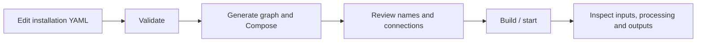

# Use Vision Engine Services

[Handbook](README.md) / Usage

## The operating model

You edit configuration. The controller validates it and generates the resolved
pipeline plus Docker Compose definitions. Docker builds images and starts service
instances. Each running service loads its configuration, receives its inputs,
processes work and exposes its outputs. The controller does not need to remain
running and does not automatically watch for YAML changes.



## 1 · Set the installation values

Start with [configuration setup](../config/README.md#prepare-installation-files).
Edit files under `config/YAMLs/`, not the versioned samples or generated outputs.

| What you change | Where |
|---|---|
| Development/production, device identity, heartbeat | `device.yaml` |
| Camera source, enabled state, assigned model and zones | `cameras.yaml` |
| Weights, accelerator, inference thresholds and tracker choice | `models.yaml` |
| Tracker parameters | `boxmot_tracker.yaml` |
| Rule matching, schedules, cooldowns and notification table | `rules.yaml` |
| Webhook and email channels | `notifications.yaml` |
| Collection destination, sessions, sampling and limits | `collection.yaml` |
| Backend connection, batching and durable buffer | `api.yaml` |
| Node templates, optional branches and connection policies | `graph.yaml` |

Use UTC for schedules. Supply local model assets and any enabled SMTP secrets.
Camera/model/rule references must agree across files. New service behavior requires
implementation as well as graph configuration; see [extensions](EXTENDING.md).

## 2 · Validate before starting

From the repository root, with the controller dependency installed:

```console
python -m config.controller --details
python -m config.controller --plan
```

Validation errors identify the file/field to fix. A valid plan is not a camera,
model-file or hardware availability check. `--plan` prints resolved nodes/edges
and starts no services.

## 3 · Generate and understand the output

```console
python -m config.controller --generate
```

| File | Read it to see |
|---|---|
| `config/.generated/pipeline.yaml` | Enabled graph nodes, concrete edges and policies |
| `config/.generated/pipeline.compose.yaml` | Project name, endpoint maps, volumes and includes |
| `config/.generated/<service>.compose.yaml` | Actual image, container arguments, ports and mounts for that service type |

The generator expands instances for enabled cameras, used models and enabled
collector sessions. Shared stages run once as selected by the graph. An inactive
branch is omitted; an unsupported planned stage is reported in `omitted_nodes`.
Generated files should stay together and are recreated from installation values.

## 4 · Review the names

```console
docker compose -f config/.generated/pipeline.compose.yaml config --services
```

Development uses project `visionengine-development-edge`; production uses
`visionengine-production-edge`. An image is shared software such as
`visionengine-camera:local`. A Compose service is one instance such as
`visionengine-camera-service-entrance`. Docker adds project and replica number to
form its container name. [Complete naming rules](NAMING.md)

> [!IMPORTANT]
> Changing the environment selects a different default Docker volume namespace.
> Existing buffer/journal data is not moved automatically. Keep names and storage
> paths stable during routine updates. [Storage and recovery](STORAGE.md)

## 5 · Start and inspect

```console
docker compose -f config/.generated/pipeline.compose.yaml up --build -d --remove-orphans
docker compose -f config/.generated/pipeline.compose.yaml ps
docker compose -f config/.generated/pipeline.compose.yaml logs -f --tail 20 --no-log-prefix
```

Starting ingest sends buffered rows to the configured backend. Enabled notifier
channels can send live webhooks/email. Review those destinations before starting.
Inspect INPUT, PROCESS and OUTPUT counters, then use [message receivers](OBSERVABILITY.md)
for exact payloads. An empty detection/alert batch can be valid. Do not interpret
local publisher counts as acknowledged end-to-end delivery.

## 6 · Stop or update

```console
docker compose -f config/.generated/pipeline.compose.yaml stop
```

The command stops containers and preserves data. `up --no-build -d` resumes using
existing images. For code changes, [build only the affected image](UPDATES.md) and
recreate every affected instance. For YAML changes, validate/generate and reload
the affected processes; a host-file edit alone does not reload running services.

## 7 · Find your data

Collected images/labels live on the host under `collection.output_dir`, normally
`collected/<session_id>/`. In Docker, buffer and row-builder databases live on named
volumes, not in image layers. Native Python runs can use `data/`. Model files are
supplied under their configured paths, commonly `models/`.
[Exact paths, persistence and backup instructions](STORAGE.md)

## Where to go next

[First device deployment](DEPLOYMENT.md) · [Naming](NAMING.md) ·
[Selective updates](UPDATES.md) · [Troubleshooting](TROUBLESHOOTING.md)
