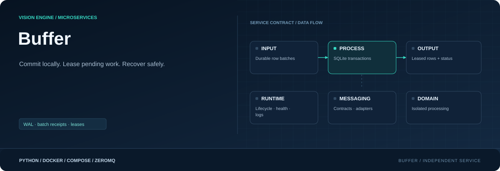

<div align="center">



**Commit rows locally. Lease pending work. Recover across restarts.**

[](requirements.txt)
[](Dockerfile)
[](#responsibility)

[Project](../../README.md) · [Services](../README.md) · [Configuration](../../config/README.md) · [Handbook](../../docs/README.md)

</div>

## Responsibility

| Property | Value |
|---|---|
| Instance scope | One shared database owner |
| Input | Acknowledged rows.v1 puts |
| Output | Leased batches + status |
| Image | `visionengine-buffer:local` |
| Generated file | `config/.generated/buffer.compose.yaml` |
| Entry point | `python -m services.buffer` |

## Storage owner and responsibilities

Only buffer opens its SQLite database. It stores detection, notification and node
rows, and serves the existing ingest claims. It does not store camera images or
monitor snapshot files. Ingest polling, the configurable row batch size (currently
50) and flush interval (currently 5 seconds), HTTP grouping and backend UUIDs are
unchanged.

| Responsibility | Owner / tables |
|---|---|
| Intake: validate, persist, acknowledge | RPC serving thread; one short transaction |
| Pending payload | `rows`, with destination table and lease state |
| Producer duplicate protection | `producers` checkpoints and `source_batches` for unretired handoffs only |
| HTTP delivery/recovery | `deliveries` for unfinished groups; `leases` for live/recent claims |
| Bounded cleanup/reclamation | Separate maintenance thread and SQLite connection |

These are logical responsibilities in one database, not independent SQLite
schemas/writers. SQLite still serializes writes. Intake never calls cleanup
before replying. Cleanup runs every second, deletes at most 256 expired tokens per
pass, uses a 20 ms lock timeout to yield to serving work, a passive WAL checkpoint,
and incremental reclamation of at most 64 pages. Errors are surfaced by the
service rather than silently disabling maintenance.

`api.yaml` supplies `buffer.path`, `max_size_mb` and retry settings.
`delete_after_hours` remains accepted for configuration compatibility; confirmed
payloads are now deleted in the backend ACK transaction, rather than retained for
hours. There is no seven-day receipt retention or `--receipt-days` setting.
WAL and `synchronous=FULL` are retained. Physical durability requires storage that
honors flushes.

## Producer handoff: UUID, SHA-256 and retirement

Each new journal entry has a persistent UUIDv4, a monotonically increasing
sequence, and SHA-256 over canonical JSON of its `rows` (sorted keys, compact
separators, finite numbers). A persistent producer UUID identifies the journal,
not a camera or process lifetime. Retries preserve identity, sequence and content.

A put carries `batch_id`, `batch`, `producer_id`, `sequence`, `digest`, and
`retired_through`. Buffer checks the hash and identity and atomically stores the
source record, rows and saved checkpoint. It replies only after commit.
Same UUID/sequence/hash returns the original row count without another insert.
Conflicting identity/content or a sequence gap is rejected. This is transactional
validation, not a separate background check that could race an insert.

Row builder advances `retired_through` only in the transaction deleting its
oldest confirmed journal entry. Buffer removes source UUID/hash records through
that checkpoint without deleting their undelivered rows. Continuous traffic
piggybacks retirement on puts; an idle journal explicitly sends `retire`, including
after restart. Buffer retains one saved/retired checkpoint per producer. Old
messages at or below retirement are acknowledged and ignored even after their
source UUID/hash has been removed. A count of zero waiting batches alone is not
used as a deletion fence.

A journal must not be rolled back to an older backup against newer buffer state.
Do not erase the producer/checkpoint tables independently to recover capacity.
An abandoned producer leaves its checkpoint and any unretired handoffs; explicit
producer decommissioning requires stopping/fencing it, not guessing that retries
have ended.

## Request/reply operations

| Operation | Result |
|---|---|
| `put(batch_id, batch, producer_id, sequence, digest, retired_through=0)` | Commit new rows or acknowledge a matching/retired retry |
| `retire(producer_id, retired_through)` | Persist monotonic retirement; delete covered source records |
| `peek(limit, max_bytes)` | Inspect pending rows without reserving |
| `claim(limit, lease_seconds, max_bytes)` | Legacy lease of unassigned rows |
| `claim_delivery(limit, lease_seconds, max_bytes)` | Persist/lease one single-table group with stable UUIDv4 |
| `renew(lease_id, lease_seconds)` | Extend a live lease |
| `ack(lease_id, ids?)` | Confirm backend delivery, delete confirmed payload and completed delivery metadata atomically |
| `release(lease_id)` | Return unconfirmed members to pending and remove the temporary lease |
| `stats()` | Live/physical bytes, producer/source counts, pending/inflight and cumulative counters |

Version-1 envelopes still use correlated ZeroMQ REQ/REP. Row builder reuses its
successful request socket; a timeout discards it before retrying. The changed put contract
requires coordinated row-builder/buffer deployment. Claims keep the existing
`buffer.delivery.v1` shape. Defaults remain 50 rows, 60-second leases and 8 MiB;
limits are 1000 rows, 16 MiB and one-hour leases. Expired leases become pending
across restarts. Late ACKs cannot complete newly claimed rows.

## Backend delivery and bounded replay bookkeeping

Buffer still regroups rows by destination table and persists each delivery UUID
and exact row membership before returning it to ingest. Release, lease expiry
and restart preserve that UUID, order and payload. Uncertain retries are never
repackaged under a new UUID. Ingest is unchanged and sends it as backend
`batch_id`; the receipt-aware backend remains the durable duplicate authority.

Backend-confirmed rows and their completed delivery records are deleted
transactionally. A completed lease token permits lost-ACK response replay until
its original expiry, with at most 1024 completed tokens retained. Beyond that
bounded replay window ingest's existing `invalid_lease` recovery applies; a late
ACK can be reported ambiguous even if rows were already confirmed, but it cannot
delete a different lease's rows. Active/pending deliveries are never purged merely
for age or capacity. Legacy partial ACKs remain supported for legacy claims;
stable HTTP deliveries require a full ACK.

## Capacity and limits

`pending` includes leased unsent rows; `inflight` is its leased subset. No capacity
path deletes pending or inflight rows. `dropped_pending_total` remains observable
and should stay zero for this schema. A full buffer rejects new intake atomically,
so journaled batches remain with row builder for retry.

Admission uses occupied SQLite pages, excluding reusable free pages, rather than
rejecting just because a previously large file has not shrunk. Intake stops at
85% projected live usage and rolls back a batch that would exceed 90%, preserving
headroom for claims, confirmations and retirement. SQLite `max_page_count`
separately caps the main database at the configured whole-page size.
`live_bytes` and `main_bytes` expose those values. `size_mb`/`disk_bytes` include
database + WAL + SHM; transient WAL/SHM can exceed the main-page limit. This is
**not a hard filesystem quota**. WAL autocheckpoint is 128 pages, retained WAL
target is 1 MiB, and maintenance reuses/reclaims free space. Lowering the
configured page ceiling below an existing main file fails explicitly; it does
not silently use a larger SQLite page ceiling.

Finite storage cannot absorb unlimited outages or intake above delivery capacity.
Backend latency, source payload size and durable commit time determine the actual
rate; one million rows per second is not guaranteed. If buffer fills, the bounded
producer journal can also fill, and upstream live queues can still drop input
before it is journaled. That earlier loss boundary is unchanged by this patch.

## Development reset / compatibility

Schema version is now **3**. Version-1/2 buffer files and nonempty legacy producer
journals fail closed with an explicit-reset/migration error. No automatic deletion
or lossy migration runs. For a development rollout, stop the owners and choose
fresh buffer **and producer journal** paths/volumes together; preserve the old
pair if recovery matters. Do not point a progressed journal at an empty buffer,
or reset a buffer's checkpoints while keeping its old journal. This patch neither
deletes existing local/Jetson data nor deploys changes.

## Recorded local checks

Before removal of the temporary test directory, 17 isolated regression checks
passed: duplicates/conflicts, durable checkpoints, lost acknowledgments, restart,
stable backend grouping, capacity rejection without eviction, resume after drain,
bounded bookkeeping and journal limits. Benchmark measurements and their limits
are retained in [buffer handoff](../../docs/BUFFER_HANDOFF.md). Test/benchmark
scripts were removed at the user's request; no test runner is included.

## Endpoints and inspection

| Endpoint | Container | Host |
|---|---|---|
| RPC puts/claims/ACK/stats | 5564 | 14000 |
| `buffer.status.v1/<device_id>` | 5565 | 15000 |

`buffer.pending` in generated metadata identifies the pull/RPC interface;
`buffer.status` is an observational PUB feed. Buffer does not subscribe to row
builder's diagnostic PUB. It has no upstream startup dependencies.

```console
python -m config.controller --generate
docker compose -f config/.generated/pipeline.compose.yaml up --build -d visionengine-buffer-service
docker compose -f config/.generated/pipeline.compose.yaml exec visionengine-buffer-service python -m services.buffer.tools.client --connect tcp://127.0.0.1:5564 --operation stats --format json
docker compose -f config/.generated/pipeline.compose.yaml exec visionengine-buffer-service python -m services.buffer.tools.client --connect tcp://127.0.0.1:5564 --operation peek --limit 5 --format json
```

For native options, install `services/buffer/requirements.txt` and run
`python -m services.buffer --help`. Its fresh serving-loop snapshot lets monitor
read actual pending state even when empty. Unavailable/stale snapshots are unknown.

> [!IMPORTANT]
> Normal recreation preserves `buffer_data` and `delivery_row_builder`. Volume
> deletion or a new project namespace changes that behavior. Back up SQLite with
> its online API or stop its owner before copying the complete directory.

## Source map

| Location | Responsibility |
|---|---|
| [__main__.py](__main__.py) | Module entry point |
| [Dockerfile](Dockerfile) | Image layers, packaged code, entry point and healthcheck |
| [requirements.txt](requirements.txt) | Runtime dependencies |
| `messaging/` | Service-local wire contracts, validation and input/output adapters: [protocol.py](messaging/protocol.py), [publisher.py](messaging/publisher.py), [rows.py](messaging/rows.py) |
| `runtime/` | Configuration, CLI lifecycle, logging and independent healthcheck: [configuration.py](runtime/configuration.py), [healthcheck.py](runtime/healthcheck.py), [logging.py](runtime/logging.py), [service.py](runtime/service.py) |
| `storage/` | Owned persistence, transactional recovery and storage limits: [database.py](storage/database.py) |
| `tools/` | Diagnostic receivers and inspection utilities: [client.py](tools/client.py), [receiver.py](tools/receiver.py) |

## Operating notes

Run commands from the repository root. Use IDs from your installation; examples
use camera `entrance`, model `people` and device `node-01`. Host ports can change
with generated instance order; the umbrella endpoint maps are authoritative.

[Update only this image](../../docs/UPDATES.md) · [Inspect connections](../../docs/OBSERVABILITY.md) · [Storage and recovery](../../docs/STORAGE.md)
