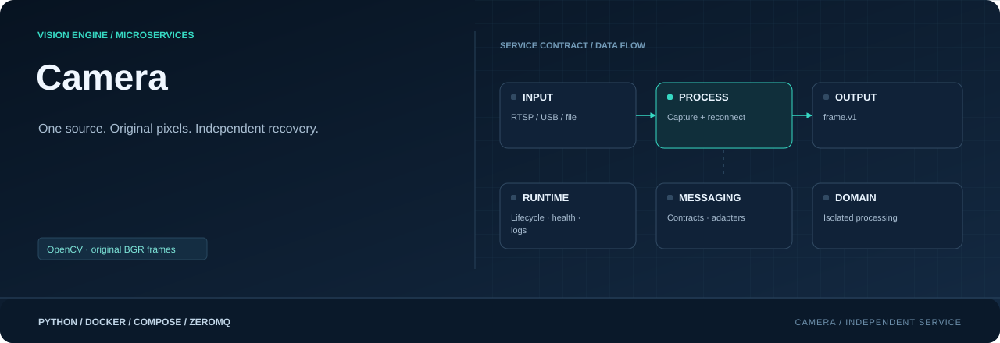

<div align="center">



**Open one source. Publish original frames. Recover independently.**

[](requirements.txt)
[](Dockerfile)
[](#responsibility)

[Project](../../README.md) · [Services](../README.md) · [Configuration](../../config/README.md) · [Handbook](../../docs/README.md)

</div>

## Responsibility

| Property | Value |
|---|---|
| Instance scope | One per enabled camera |
| Input | RTSP, USB or video file |
| Output | Original frame.v1 pixels |
| Image | `visionengine-camera:local` |
| Generated file | `config/.generated/camera.compose.yaml` |
| Entry point | `python -m services.camera` |

## Capture lifecycle

`CameraSource` owns OpenCV open/read/reconnect/close. `CameraWorker` drives it on
one capture thread and hands frames to a bounded buffer. The runtime thread
publishes queued frames and handles status, signals and native-operation timeout.
Source recovery is independent of inference and other downstream work.

Only `cameras.yaml` selects the enabled camera. USB sources are integers, RTSP
uses URLs, and file paths resolve from the working directory. Windows paths are
not Linux container paths. `fps_target` is an analysis target, not live capture
throttling. No model, tracker or GPU is required.

## Output contract

| Multipart part | Contents |
|---|---|
| Topic | `frame.v1/<camera_id>` |
| Header | UTF-8 JSON with camera/stream/sequence, timestamp, encoding and size |
| Pixels | Contiguous `uint8` BGR, `height × width × 3` bytes |

```json
{
  "message_type": "frame.v1", "camera_id": "entrance",
  "stream_id": "camera-process-session", "sequence": 42,
  "received_at_ns": 1792000000000000000, "timestamp_origin": "host_decode",
  "encoding": "raw", "pixel_format": "bgr8",
  "width": 960, "height": 480, "payload_bytes": 1382400
}
```

Sequence increases across reconnects; process restart changes stream ID. Timestamp
is host receipt after decode, not sensor exposure. Decoder validation checks exact
payload size and dimensions. The frame ceiling is 64 MiB. No pickle, compression,
shared GPU-memory handle or browser protocol is used. Raw 1080p BGR at 12 FPS is
about 75 MB/s per subscriber before transport overhead.

## Run and inspect

```console
python -m config.controller --generate
docker compose -f config/.generated/pipeline.compose.yaml up --build -d visionengine-camera-service-entrance
docker compose -f config/.generated/pipeline.compose.yaml logs -f --tail 20 visionengine-camera-service-entrance
docker compose -f config/.generated/pipeline.compose.yaml exec visionengine-camera-service-entrance python -m services.camera.tools.receiver --connect tcp://127.0.0.1:5555 --camera-id entrance --count 1 --save /tmp/frame.jpg
```

Compose mounts configuration read-only. Container consumers use
`tcp://visionengine-camera-service-entrance:5555`; host ports start at 5555.
Each instance has its own container port 5555 and a distinct host mapping.

```console
python -m pip install -r services/camera/requirements.txt
python -m services.camera --camera-id entrance
python -m services.camera --help
```

Native files default to stopping at EOF; generated deployment uses
`--file-mode loop`. `--file-fps` controls file playback pace. Live sources reconnect
on failures. `--max-frames` limits local publish calls, not subscriber delivery.
Start receivers before short files; subscription setup is asynchronous. Receiver
has a default 30-second total deadline; adjust `--timeout` for slower startup.

## Buffering, health and hardware

The capture queue defaults to two frames, 16 MiB and 500 ms local age with
drop-oldest overflow. Socket queues are finite too. PUB/SUB is best effort, with
no replay or delivery ACK. Each subscriber gets its own copy; subscribers do not
split frames between them.

INPUT logs show capture/FPS/reconnects; OUTPUT shows published/FPS/queued bytes/
drops. Generated health snapshots use unique `/health` paths on shared storage.
Watchdog exit allows Docker process recovery; an unhealthy flag alone does not
restart the container. Runtime temporary files are not baked into the image.

Linux USB capture needs device passthrough; generation adds `/dev/videoN` for
integer sources. Docker Desktop does not automatically expose Windows webcams.
RTSP must be reachable from inside the container. Capture is CPU OpenCV;
DeepStream/NVDEC is not implemented here.

## Source map

| Location | Responsibility |
|---|---|
| [__main__.py](__main__.py) | Module entry point |
| [Dockerfile](Dockerfile) | Image layers, packaged code, entry point and healthcheck |
| [requirements.txt](requirements.txt) | Runtime dependencies |
| `capture/` | OpenCV source lifecycle, capture worker and local buffering: [source.py](capture/source.py), [worker.py](capture/worker.py) |
| `messaging/` | Service-local wire contracts, validation and input/output adapters: [frames.py](messaging/frames.py), [publisher.py](messaging/publisher.py) |
| `runtime/` | Configuration, CLI lifecycle, logging and independent healthcheck: [configuration.py](runtime/configuration.py), [healthcheck.py](runtime/healthcheck.py), [logging.py](runtime/logging.py), [service.py](runtime/service.py) |
| `tools/` | Diagnostic receivers and inspection utilities: [receiver.py](tools/receiver.py) |

## Operating notes

Run commands from the repository root. Use IDs from your installation; examples
use camera `entrance`, model `people` and device `node-01`. Host ports can change
with generated instance order; the umbrella endpoint maps are authoritative.

[Update only this image](../../docs/UPDATES.md) · [Inspect connections](../../docs/OBSERVABILITY.md) · [Storage and recovery](../../docs/STORAGE.md)
