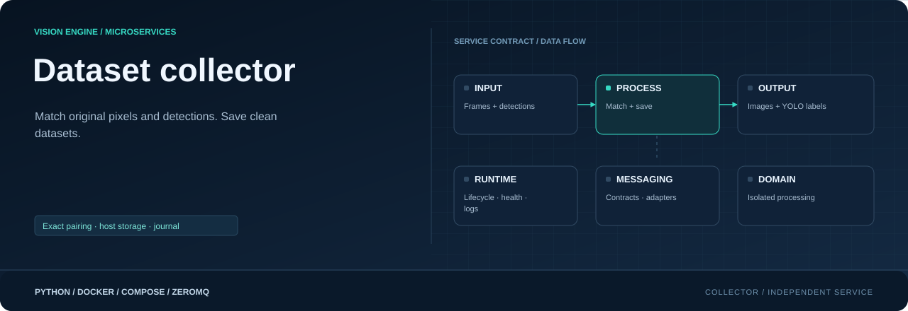
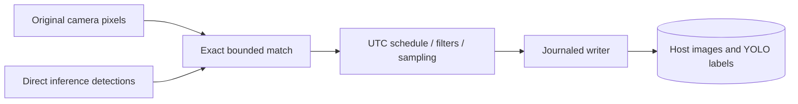

<div align="center">



**Pair original pixels with detections. Save clean YOLO datasets.**

[](requirements.txt)
[](Dockerfile)
[](#responsibility)

[Project](../../README.md) · [Services](../README.md) · [Configuration](../../config/README.md) · [Handbook](../../docs/README.md)

</div>

## Responsibility

| Property | Value |
|---|---|
| Instance scope | One per enabled collection session |
| Input | Original frame + direct detections |
| Output | Host images, labels + status |
| Image | `visionengine-collector:local` |
| Generated file | `config/.generated/collector.compose.yaml` |
| Entry point | `python -m services.collector` |

## Independent dataset branch

Collector observes original camera `frame.v1` and direct inference
`detections.v1`. It does not open another camera connection, use tracked output,
draw preview boxes or upload data. Direct inference preserves objects that might
not yet be confirmed by tracking. Collection does not depend on rules/notifications.



## Define a collection session

Read `collection.yaml`, `cameras.yaml` and `models.yaml`. Session IDs create folder
names and Compose instances. Enabled sessions need enabled, correctly assigned
cameras. Use the complete [sample](../../config/config_sample/collection.sample.yaml).

```yaml
collection:
  output_dir: ./collected
  sessions:
    - id: entrance_dataset
      camera: entrance
      enabled: true
      schedule:
        after: null
        before: null
        start_date: null
        end_date: null
      sampling:
        mode: interval
        interval_seconds: 5
        frames_per_minute: null
      filters:
        classes: [person]
        min_confidence: 0.7
        min_detections: 1
      save:
        annotated: false
        raw: true
        metadata: false
      max_frames: 500
```

Schedules use frame capture receipt in **UTC**, with inclusive date/time boundaries.
There is no timezone setting and no overnight collection window. `null` removes
that limit. Interval saves wait the configured interval after successful saves;
random mode chooses one next interval at 0.5..1.5 × 60/rate after a successful save.
On-detection requires at least one qualifying object. Interval/random can save
backgrounds with `min_detections: 0`. Only qualifying objects appear in labels.

`save.raw` must be true, `save.annotated` false. Labels are always written;
`save.metadata` only controls a JSON sidecar. `max_frames` counts committed samples
across restarts; zero means unlimited. Five hundred images is not five hundred
people: forty objects in one saved frame can mean forty label lines in one sample.

## Data layout and access

Compose resolves relative output_dir from the repository root and bind-mounts it
at `/data/collected`. Native execution uses its working directory.

```text
collected/entrance_dataset/
├── data.yaml
├── images/<sample_id>.jpg
├── labels/<sample_id>.txt
├── metadata/<sample_id>.json   # optional
├── .collector.sqlite3
├── .collector.lock
├── .pending/
└── .quarantine/
```

JPEG quality 95 preserves unannotated source pixels subject to JPEG compression.
Image/label names share deterministic SHA-256 IDs derived from camera/stream/sequence.
Each label line is `class_id center_x center_y width height`, normalized to 0..1,
six decimals. Class IDs follow configured model class order recorded in `data.yaml`.
Empty TXT labels are valid backgrounds. The descriptor is portable; train/val
initially both reference `images`. Split and review model-predicted annotations
before training or exporting to an annotation tool.

Default `collected/` is ignored by Git and Docker build context. New output roots
receive an ignore file if none exists. Add custom roots to `.dockerignore` too.
Image rebuilds do not remove host data. Export images/labels/data.yaml for annotation;
retain the entire session including journal when backing up for resumed collection.

## Matching, storage and recovery

Frames/results must match camera, stream, sequence, receipt timestamp and dimensions.
Separate item/byte/age-bounded caches accept either arrival order. Missing old
pairs do not block newer ready pairs; late older/retired-stream work is discarded.
Graph defaults use 64 frames / 64 MiB / five seconds and 32 results / 4 MiB /
five seconds. Transport queues are also bounded and remain best effort.

An OS lock enforces one writer per session. Files are encoded/validated, staged
and fsynced; journal pending state commits, label/metadata/image are published
(image last), then completion commits. Restart finishes valid partial saves and
quarantines invalid ones without counting them. The journal is completion authority;
multiple files cannot appear atomically. Physical power-loss durability depends
on the storage/filesystem and is not a software-only guarantee.

Journal state preserves saved count and deduplication. Changed camera/class maps
or unjournaled existing datasets require a new session or explicit migration.
Changing weights with the same class mapping can append samples. At the cap,
collector remains healthy/completed and disconnects inputs; increase cap and
restart to continue. Sampling deadlines reset on restart.

The default free-space reserve is 256 MiB (`--min-free-mb`). Space/encoding/write
failures increment counters and dependency errors while retaining prior data.
No automatic old-dataset deletion exists. Persistent journals/quarantine also
consume space; use storage suitable for the expected volume.

## Run and inspect

```console
python -m config.controller --generate
docker compose -f config/.generated/pipeline.compose.yaml up --build -d visionengine-collector-service-entrance-dataset
docker compose -f config/.generated/pipeline.compose.yaml exec visionengine-collector-service-entrance-dataset python -m services.collector.tools.inspect --output-dir /data/collected --session-id entrance_dataset --verify
docker compose -f config/.generated/pipeline.compose.yaml exec visionengine-collector-service-entrance-dataset python -m services.collector.tools.receiver --connect tcp://127.0.0.1:5568 --session-id entrance_dataset --count 5 --format json
```

Status `collector.status.v1/<session_id>` uses container 5568, host start 18000.
The inspector is read-only; `--verify` checks saved hashes. Manually edited labels
will differ by design. Stop collection before exporting a consistent folder.
Native execution after installing `services/collector/requirements.txt`:

```console
python -m services.collector --session-id entrance_dataset --frames-input tcp://127.0.0.1:5555 --detections-input tcp://127.0.0.1:6000
```

The lightweight image contains OpenCV, not Torch/YOLO. An isolated writer and
native-operation watchdog keep storage work separate from inference. Source
compatibility retains Edge's YOLO layout/filtering while adding exact matching,
checked JPEG writes, persistent counts, class-map fencing and recoverable writes.

## Source map

| Location | Responsibility |
|---|---|
| [__main__.py](__main__.py) | Module entry point |
| [Dockerfile](Dockerfile) | Image layers, packaged code, entry point and healthcheck |
| [requirements.txt](requirements.txt) | Runtime dependencies |
| `messaging/` | Service-local wire contracts, validation and input/output adapters: [detections.py](messaging/detections.py), [frames.py](messaging/frames.py), [publisher.py](messaging/publisher.py), [subscriber.py](messaging/subscriber.py) |
| `processing/` | Domain logic, bounded work queues and worker state: [filters.py](processing/filters.py), [matcher.py](processing/matcher.py), [worker.py](processing/worker.py) |
| `runtime/` | Configuration, CLI lifecycle, logging and independent healthcheck: [configuration.py](runtime/configuration.py), [healthcheck.py](runtime/healthcheck.py), [logging.py](runtime/logging.py), [service.py](runtime/service.py) |
| `storage/` | Owned persistence, transactional recovery and storage limits: [dataset.py](storage/dataset.py) |
| `tools/` | Diagnostic receivers and inspection utilities: [inspect.py](tools/inspect.py), [receiver.py](tools/receiver.py) |

## Operating notes

Run commands from the repository root. Use IDs from your installation; examples
use camera `entrance`, model `people` and device `node-01`. Host ports can change
with generated instance order; the umbrella endpoint maps are authoritative.

[Update only this image](../../docs/UPDATES.md) · [Inspect connections](../../docs/OBSERVABILITY.md) · [Storage and recovery](../../docs/STORAGE.md)
