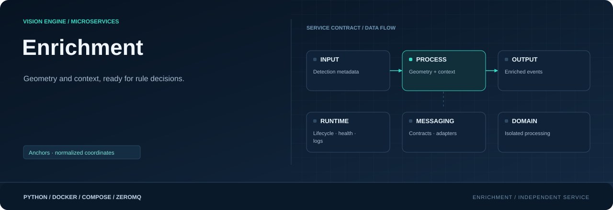

<div align="center">



**Extend object metadata with geometry and camera context.**

[](requirements.txt)
[](Dockerfile)
[](#responsibility)

[Project](../../README.md) · [Services](../README.md) · [Configuration](../../config/README.md) · [Handbook](../../docs/README.md)

</div>

## Responsibility

| Property | Value |
|---|---|
| Instance scope | One per enabled camera |
| Input | Tracked or direct detections |
| Output | Enriched event.v1 |
| Image | `visionengine-enrichment:local` |
| Generated file | `config/.generated/enrichment.compose.yaml` |
| Entry point | `python -m services.enrichment` |

## Geometry and context

This small CPU stage consumes metadata, not pixels. It adds geometry and camera/
model context. Zone matching is in rules; no model, GPU, delivery or row mapping
runs here. The graph selects tracking when enabled, otherwise direct inference.
Existing camera/model configuration is sufficient; no enrichment YAML is needed.

## Enriched event fields

| Field | Meaning |
|---|---|
| `class_name`, `confidence`, `bbox`, `track_id` | Preserved object data; ID can be null |
| `bbox_w`, `bbox_h`, `center_x`, `center_y` | Box dimensions and center in source pixels |
| `anchor_x`, `anchor_y` | Pixel anchor, rounded to one decimal |
| `anchor_x_norm`, `anchor_y_norm` | Normalized anchor, rounded to four decimals |
| `camera_id`, `camera_name`, `model_id` | Configured context |
| `frame_w`, `frame_h`, `capture_ts` | Frame size and UTC host-decode receipt |
| `attributes` | Existing mapping or empty mapping; no attribute model runs |

Person anchors use bottom-center except a box reaching `frame_h - 1` uses its
center for clipped feet. Other classes use center. Normalization uses full precision
before rounding. This preserves Edge's anchor convention while zones belong to rules.

Output is topic `event.v1/<camera_id>` plus JSON on container 5559, host start 9000.
`detections` becomes `events`; source/model/inference/tracking metadata remains.
`enrichment` adds completion nanoseconds and elapsed milliseconds. Empty inputs
still publish. ISO capture text is microsecond precision; the original nanosecond
receipt remains in the envelope.

## Run and inspect

```console
python -m config.controller --generate
docker compose -f config/.generated/pipeline.compose.yaml up --build -d visionengine-enrichment-service-entrance
docker compose -f config/.generated/pipeline.compose.yaml exec visionengine-enrichment-service-entrance python -m services.enrichment.tools.receiver --connect tcp://127.0.0.1:5559 --camera-id entrance --count 5 --format json
```

```console
python -m pip install -r services/enrichment/requirements.txt
python -m services.enrichment --camera-id entrance --input tcp://127.0.0.1:8000
```

Without tracking, use the assigned inference detections endpoint instead.

## Processing and recovery

A receiver validates input; the processing worker owns output. Queue defaults are
32 batches / 4 MiB / five seconds, drop oldest. Supported graph policies become
CLI limits. Duplicate/out-of-order batches and retired streams are discarded using
bounded history and capture receipt timestamps.

Counters report received/processed/sent rates, drops, rejects and enrichment time.
Generated snapshots use unique `/health` paths. Recent empty batches count as
progress. Docker restarts exited processes, not merely unhealthy ones. Transport
has no replay, persistent queue or delivery ACK.

## Source map

| Location | Responsibility |
|---|---|
| [__main__.py](__main__.py) | Module entry point |
| [Dockerfile](Dockerfile) | Image layers, packaged code, entry point and healthcheck |
| [requirements.txt](requirements.txt) | Runtime dependencies |
| `messaging/` | Service-local wire contracts, validation and input/output adapters: [detections.py](messaging/detections.py), [events.py](messaging/events.py), [publisher.py](messaging/publisher.py), [subscriber.py](messaging/subscriber.py) |
| `processing/` | Domain logic, bounded work queues and worker state: [enricher.py](processing/enricher.py), [worker.py](processing/worker.py) |
| `runtime/` | Configuration, CLI lifecycle, logging and independent healthcheck: [configuration.py](runtime/configuration.py), [healthcheck.py](runtime/healthcheck.py), [logging.py](runtime/logging.py), [service.py](runtime/service.py) |
| `tools/` | Diagnostic receivers and inspection utilities: [receiver.py](tools/receiver.py) |

## Operating notes

Run commands from the repository root. Use IDs from your installation; examples
use camera `entrance`, model `people` and device `node-01`. Host ports can change
with generated instance order; the umbrella endpoint maps are authoritative.

[Update only this image](../../docs/UPDATES.md) · [Inspect connections](../../docs/OBSERVABILITY.md) · [Storage and recovery](../../docs/STORAGE.md)
