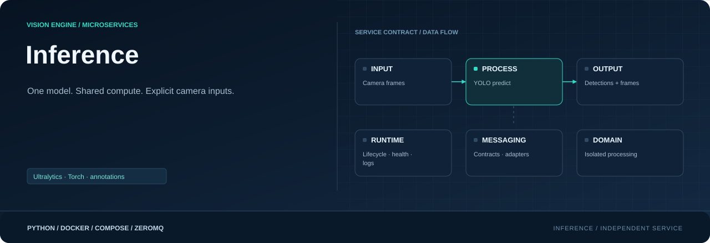

<div align="center">



**Load one model. Share compute across assigned cameras.**

[](requirements.txt)
[](Dockerfile)
[](#responsibility)

[Project](../../README.md) · [Services](../README.md) · [Configuration](../../config/README.md) · [Handbook](../../docs/README.md)

</div>

## Responsibility

| Property | Value |
|---|---|
| Instance scope | One per used model |
| Input | Selected camera frames |
| Output | Detections + annotated frames |
| Image | `visionengine-inference:local` |
| Generated file | `config/.generated/inference.compose.yaml` |
| Entry point | `python -m services.inference` |

## Model ownership

One process loads one Ultralytics detection model and calls `predict()`, never
`track()`. A receiver thread handles cameras; one worker schedules their model
work fairly. Tracking is separate. `models.yaml` supplies assets, thresholds,
classes, input size and device; `cameras.yaml` supplies assignments and FPS targets.
Missing assets or unknown model classes fail explicitly. No automatic weight download.

## Two correlated outputs

| Output | Container | Host start | Topic |
|---|---|---|---|
| Detection JSON | 5556 | 6000 | `detections.v1/<camera_id>` |
| Annotated raw frame | 5557 | 7000 | `frame.v1/<camera_id>` |

```json
{
  "message_type": "detections.v1", "camera_id": "entrance",
  "stream_id": "camera-session", "sequence": 42,
  "received_at_ns": 1792000000000000000, "width": 960, "height": 480,
  "model_id": "people", "model_version": "configured-version",
  "processed_at_ns": 1792000000010000000, "inference_ms": 10.0,
  "detections": [
    {"class_name": "person", "confidence": 0.91,
     "bbox": [10, 20, 150, 300], "track_id": null}
  ]
}
```

Boxes are source pixel `[x1,y1,x2,y2]`. Camera/stream/sequence, capture timestamp
and dimensions correlate pixels with detections. Empty results still publish.
Annotation draws on a copy and adds stage/model/count metadata to the three-part
frame message. Detection JSON uses topic + JSON. The outputs are independent;
raw ZeroMQ frames are not a browser RTSP/WebRTC feed.

## Run and inspect

```console
python -m config.controller --generate
docker compose -f config/.generated/pipeline.compose.yaml up --build -d visionengine-inference-service-people
docker compose -f config/.generated/pipeline.compose.yaml exec visionengine-inference-service-people python -m services.inference.tools.receiver --connect tcp://127.0.0.1:5556 --camera-id entrance --count 5 --format json
docker compose -f config/.generated/pipeline.compose.yaml exec visionengine-inference-service-people python -m services.inference.tools.receiver --connect tcp://127.0.0.1:5557 --camera-id entrance --kind frames --count 1 --save /tmp/annotated.jpg
```

Compose mounts settings/models read-only and generates `--input` from graph edges.
Starting this service also starts its camera dependencies. Native example:

```console
python -m pip install -r services/inference/requirements.txt
python -m services.inference --model-id people --input entrance=tcp://127.0.0.1:5555 --bind tcp://0.0.0.0:5556 --annotated-bind tcp://0.0.0.0:5557
```

Repeat `--input` for other assigned cameras. Omitting `--annotated-bind` in a native
run disables drawing/copying/annotated publication work.

## Device and backend support

Accelerators pass through to Ultralytics: `cpu`, `cuda`, `cuda:0`, quoted `"0"`,
`mps`, or `auto` to omit the override. The `coreml` alias omits the Torch selector;
it requires a suitable export/Apple host and does not force Neural Engine use.
Linux Docker Desktop does not expose Apple MPS/CoreML. Axis-aligned detection is
the current adapter; segmentation, pose, classification and OBB need new contracts.

YAML `half` maps to `quantize=16/32` when supported by installed Ultralytics, otherwise
`half`. CPU/MPS retain full precision. Backend compatibility is checked at startup/
first prediction. Export runtimes need matching dependencies; runtime auto-install
is disabled with `YOLO_AUTOINSTALL=False` in the reference image.

Docker defaults to CPU Torch. NVIDIA needs compatible runtime/wheels and GPU access.
Jetson can use a vendor `BASE_IMAGE` with `INSTALL_TORCH=0` when Torch is preinstalled;
`TORCH_INDEX_URL` controls wheel installation otherwise. Generator does not choose
vendor images or GPU access automatically. Exports may depend on hardware/version/
shape/precision. [Ultralytics prediction API](https://docs.ultralytics.com/modes/predict/)

## Load and health

Per-camera defaults: two frames, 16 MiB, 500 ms local age, drop oldest. Worker
selection is round-robin and caps each camera at `fps_target`. Combined compute
limits output FPS; queue growth cannot create capacity. Wire frames support up to
64 MiB; queue bytes can be smaller. Unsupported graph policies fail generation.

Logs expose received/processed counts, drops, timings and FPS per camera. Fresh
status/recent completed work is aggregate health, not proof every camera is online.
Default native load/predict timeout is 120 seconds; watchdog exit permits recovery.
PUB/SUB has no ACK/replay and no automatic replica work distribution.

## Source map

| Location | Responsibility |
|---|---|
| [__main__.py](__main__.py) | Module entry point |
| [Dockerfile](Dockerfile) | Image layers, packaged code, entry point and healthcheck |
| [requirements.txt](requirements.txt) | Runtime dependencies |
| `messaging/` | Service-local wire contracts, validation and input/output adapters: [detections.py](messaging/detections.py), [frames.py](messaging/frames.py), [publisher.py](messaging/publisher.py), [subscriber.py](messaging/subscriber.py) |
| `processing/` | Domain logic, bounded work queues and worker state: [annotator.py](processing/annotator.py), [model.py](processing/model.py), [worker.py](processing/worker.py) |
| `runtime/` | Configuration, CLI lifecycle, logging and independent healthcheck: [configuration.py](runtime/configuration.py), [healthcheck.py](runtime/healthcheck.py), [logging.py](runtime/logging.py), [service.py](runtime/service.py) |
| `tools/` | Diagnostic receivers and inspection utilities: [receiver.py](tools/receiver.py) |

## Operating notes

Run commands from the repository root. Use IDs from your installation; examples
use camera `entrance`, model `people` and device `node-01`. Host ports can change
with generated instance order; the umbrella endpoint maps are authoritative.

[Update only this image](../../docs/UPDATES.md) · [Inspect connections](../../docs/OBSERVABILITY.md) · [Storage and recovery](../../docs/STORAGE.md)
