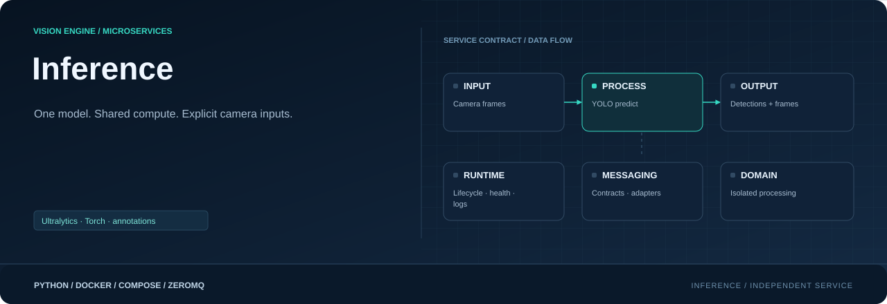

<div align="center">



**Load one model. Share compute across assigned cameras.**

[](requirements.txt)
[](Dockerfile)
[](#responsibility)

[Project](../../README.md) · [Services](../README.md) · [Configuration](../../config/README.md) · [Handbook](../../docs/README.md)

</div>

For GPU base images, NVIDIA access, per-model Compose overrides and operational
checks, follow the [GPU deployment guide](../../docs/GPU_DEPLOYMENT.md).

## Responsibility

| Property | Value |
|---|---|
| Instance scope | One per used model |
| Input | Selected camera frames |
| Output | Detections + optional annotated frames (disabled in generated deployments) |
| Image | `visionengine-inference:local` |
| Generated file | `config/.generated/inference.compose.yaml` |
| Entry point | `python -m services.inference` |

## Model ownership

One process loads one Ultralytics detection model and calls `predict()`, never
`track()`. A receiver thread handles cameras; one worker schedules prediction and
detection publication fairly. A separate optional worker draws and publishes
preview frames using its own ZeroMQ socket/context. Tracking is separate. `models.yaml` supplies assets, thresholds,
classes, input size and device; `cameras.yaml` supplies assignments and classes.
The camera service owns the YAML `fps_target` output limit; inference has no
independent FPS cap.
Missing assets or unknown model classes fail explicitly. No automatic weight download.

## Detection output and optional preview

| Output | Container | Host start | Topic |
|---|---|---|---|
| Detection JSON | 5556 | 6000 | `detections.v1/<camera_id>` |
| Annotated raw frame (when enabled) | 5557 | 7000 | `frame.v1/<camera_id>` |

```json
{
  "message_type": "detections.v1", "camera_id": "entrance",
  "stream_id": "camera-session", "sequence": 42,
  "received_at_ns": 1792000000000000000, "width": 960, "height": 480,
  "model_id": "people", "model_version": "configured-version",
  "processed_at_ns": 1792000000010000000, "inference_ms": 10.0,
  "detections": [
    {"class_name": "person", "confidence": 0.91,
     "bbox": [10, 20, 150, 300], "track_id": null}
  ]
}
```

Generated Compose currently omits `--annotated-bind`: its two command entries
are commented out in [deployment.py](../../config/controller/deployment.py).
The annotation worker is not created or started, and no preview jobs, image
copies/drawing, preview serialization or preview sends run. Detection and its
JSON publisher remain enabled. Health reports `annotation.enabled: false` and
`annotation.state: disabled`. The preview port mapping and endpoint metadata
remain present but do not imply that a preview publisher is running.

To re-enable previews for generated deployments, uncomment those two entries,
regenerate Compose, and recreate the affected inference container. The code is
preserved; this is a startup choice, not a live toggle or a YAML Boolean. A local
generator edit alone does not change an existing running deployment.

Boxes are source pixel `[x1,y1,x2,y2]`. Camera/stream/sequence, capture timestamp
and dimensions correlate pixels with detections. Empty results still publish.
Annotation draws on a copy in the preview worker and adds stage/model/count
metadata to the three-part frame message. Detection JSON uses topic + JSON.
One latest pending preview job per camera plus one job in flight bounds memory;
superseded previews are skipped without discarding detection output. Preview
failure or slow publication does not make the model worker wait. Original frame
identities/timestamps are preserved, but not every detection has a preview.
The outputs are independent;
raw ZeroMQ frames are not a browser RTSP/WebRTC feed.

## Run and inspect

```console
python -m config.controller --generate
docker compose -f config/.generated/pipeline.compose.yaml up --build -d visionengine-inference-service-people
docker compose -f config/.generated/pipeline.compose.yaml exec visionengine-inference-service-people python -m services.inference.tools.receiver --connect tcp://127.0.0.1:5556 --camera-id entrance --count 5 --format json

```

The detection receiver works with annotation disabled. JSON includes each
detection's `class_name`, `confidence` (for example, `0.91` means 91% model
confidence), and `bbox`; an empty `detections` list is valid. Use the actual camera
ID in your deployment. Port 5556 is inside the inference container; the first
host mapping is 6000. These are ZeroMQ endpoints, not browser URLs.

After explicitly enabling previews, this optional command can save one frame:

```console
docker compose -f config/.generated/pipeline.compose.yaml exec visionengine-inference-service-people python -m services.inference.tools.receiver --connect tcp://127.0.0.1:5557 --camera-id entrance --kind frames --count 1 --save /tmp/annotated.jpg
```

Compose mounts settings/models read-only and generates `--input` from graph edges.
Starting this service also starts its camera dependencies. Native example:

```console
python -m pip install -r services/inference/requirements.txt
python -m services.inference --model-id people --input entrance=tcp://127.0.0.1:5555 --bind tcp://0.0.0.0:5556
```

Repeat `--input` for other assigned cameras. The native example also disables
annotation. Add `--annotated-bind tcp://0.0.0.0:5557` to enable its worker and
preview output explicitly.

## Device and backend support

Accelerators pass through to Ultralytics: `cpu`, `cuda`, `cuda:0`, quoted `"0"`,
`mps`, or `auto` to omit the override. The `coreml` alias omits the Torch selector;
it requires a suitable export/Apple host and does not force Neural Engine use.
Linux Docker Desktop does not expose Apple MPS/CoreML. Axis-aligned detection is
the current adapter; segmentation, pose, classification and OBB need new contracts.

YAML `half` maps to `quantize=16/32` when supported by installed Ultralytics, otherwise
`half`. CPU/MPS retain full precision. Backend compatibility is checked at startup/
first prediction. Export runtimes need matching dependencies; runtime auto-install
is disabled with `YOLO_AUTOINSTALL=False` in the reference image.

Docker defaults to CPU Torch. NVIDIA needs compatible runtime/wheels and GPU access.
Jetson can use a vendor `BASE_IMAGE` with `INSTALL_TORCH=0` when Torch is preinstalled;
`TORCH_INDEX_URL` controls wheel installation otherwise. Generator does not choose
vendor images or GPU access automatically. Exports may depend on hardware/version/
shape/precision. [Ultralytics prediction API](https://docs.ultralytics.com/modes/predict/)

## Load and health

Per-camera defaults: two frames, 16 MiB, 500 ms local age, drop oldest. Worker
selection is round-robin and takes available frames immediately, without FPS
pacing. The model worker detects and publishes detections for each admitted frame,
then queues optional preview work without waiting for drawing or preview sends.
Combined model/CPU/GPU capacity still limits throughput; threads do not provide
hardware isolation or guarantee processing every incoming frame. Wire frames support up to
64 MiB; queue bytes can be smaller. Unsupported graph policies fail generation.

Logs expose received/processed counts, drops, timings and FPS per camera. Inference drops are
queue/expiry/validation safeguards, not intentional FPS pacing; processing every
received frame is not guaranteed under overload or best-effort transport. Fresh
status/recent completed work is aggregate health, not proof every camera is online.
Default native load/predict timeout is 120 seconds; watchdog exit permits recovery.
Detection health is independent of optional preview health: the `annotation`
snapshot reports its state/error, in-flight camera and per-camera queue/send/skip/
failure/cancellation counts. A preview failure is logged and leaves detection
running. Shutdown joins both workers with the configured bounded timeout; a stuck
preview thread follows the existing supervisor recovery path on shutdown.
PUB/SUB has no ACK/replay and no automatic replica work distribution.

## Source map

| Location | Responsibility |
|---|---|
| [__main__.py](__main__.py) | Module entry point |
| [Dockerfile](Dockerfile) | Image layers, packaged code, entry point and healthcheck |
| [requirements.txt](requirements.txt) | Runtime dependencies |
| `messaging/` | Service-local wire contracts, validation and input/output adapters: [detections.py](messaging/detections.py), [frames.py](messaging/frames.py), [publisher.py](messaging/publisher.py), [subscriber.py](messaging/subscriber.py) |
| `processing/` | Domain logic, bounded work queues and worker state: [annotator.py](processing/annotator.py), [model.py](processing/model.py), [worker.py](processing/worker.py) |
| `runtime/` | Configuration, CLI lifecycle, logging and independent healthcheck: [configuration.py](runtime/configuration.py), [healthcheck.py](runtime/healthcheck.py), [logging.py](runtime/logging.py), [service.py](runtime/service.py) |
| `tools/` | Diagnostic receivers and inspection utilities: [receiver.py](tools/receiver.py) |

## Operating notes

Run commands from the repository root. Use IDs from your installation; examples
use camera `entrance`, model `people` and device `node-01`. Host ports can change
with generated instance order; the umbrella endpoint maps are authoritative.

[Update only this image](../../docs/UPDATES.md) · [Inspect connections](../../docs/OBSERVABILITY.md) · [Storage and recovery](../../docs/STORAGE.md)

## Interval diagnostics

Model status and health intervals include `sample_elapsed_ms`, `frames`, `detections`,
`detections_per_frame_mean/max`, `queue_wait_ms_max`, `prediction_duration_ms_max`,
`publish_duration_ms_max` and `worker_duration_ms_max`. Publication timing now covers
detection encoding/send only. Worker duration includes prediction/result conversion,
batch construction, detection publication and enqueueing optional preview work;
it excludes waiting, annotation and preview serialization/send. `infer_ms` remains
the last model-call measurement.

When preview output is enabled, its independently sampled interval adds
`annotation_sample_elapsed_ms`, `annotation_frames`, `annotation_queue_wait_ms_max`,
`annotation_duration_ms_max`, `annotated_publish_duration_ms_max`,
`annotation_queued_frames` and cumulative `annotation_sent_total`,
`annotation_skipped_total`, `annotation_failed_total`, `annotation_cancelled_total`.
`annotated_sent_total` in publisher status counts actual preview send completions,
not queued jobs or subscriber acknowledgments. Skipped/cancelled previews do not
mean detections or accepted rows were lost. Preview failure details also appear in
the `annotation` health snapshot. These preview metrics are absent when disabled.

Fixed-size timing accumulators reset at sampling; zero completions do not rule out
in-progress latency. No per-frame INFO records, histograms or image histories are
retained. Preview/model/counter sampling boundaries are asynchronous and must not
be treated as aligned frame handoffs.
