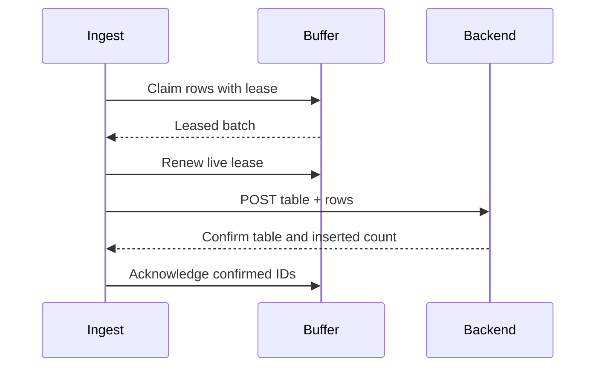

<div align="center">


**Deliver committed rows to the backend. Acknowledge confirmed inserts.**

[](requirements.txt)
[](Dockerfile)
[](#responsibility)

[Project](../../README.md) · [Services](../README.md) · [Configuration](../../config/README.md) · [Handbook](../../docs/README.md)

</div>

## Responsibility

| Property | Value |
|---|---|
| Instance scope | One shared worker |
| Input | Leased buffer.batch.v1 |
| Output | HTTP table batches + status |
| Image | `visionengine-ingest:local` |
| Generated file | `config/.generated/ingest.compose.yaml` |
| Entry point | `python -m services.ingest` |

## Delivery flow

Ingest requests rows from buffer RPC, groups by table without changing row payloads,
POSTs each group, and acknowledges confirmed row IDs. It creates no separate
database or persistence volume. Buffer remains the durable owner.



## HTTP contract

```http
POST <api.url>/branches/ingest
X-API-Key: <api.key>
Content-Type: application/json

{"table":"notifications","rows":[{"rule_name":"entrance_alert","severity":"warning"}]}
```

The body illustrates shape; actual rows have row-builder fields. Backend key
selects the branch; branch ID is not added to this body. Confirmation requires
HTTP 200/201, `success: true`, and matching `data.table`/`data.inserted` count.
Empty/malformed/wrong-count responses, timeouts and rejected requests leave the
relevant rows unsent. Successful table groups can ACK while failed groups retry.

`api.ingest` controls batching/flush cadence. `api.request` controls timeout and
failure-warning threshold; `api.buffer.retry_interval_seconds` supplies backoff
base, multiplied 1, 2, 4, then capped at 5. Warning threshold does not discard work.
Responses are bounded to 64 KiB; redirects are rejected. Logs omit credentials,
backend URLs, row bodies and raw response bodies.

## Recovery and delivery limits

Live leases renew before table requests. ACK loss retries the same ACK before
new HTTP, avoiding repost merely because a live worker missed a buffer response.
Failed members are released for retry. A killed worker's leases expire. Stop
finishes the bounded active request/ACK attempt and releases unsent rows; it does
not drain the entire backlog.

> [!IMPORTANT]
> Backend delivery is **at least once**. If insertion succeeds but its HTTP response
> is lost, or a process dies before buffer ACK commits, retries can insert duplicates.
> Exact-once backend storage requires backend idempotency support.

`ambiguous_rows_total` reports observed uncertainty, not every actual duplicate.
Buffer capacity handling still applies during long outages.

## Run and inspect

```console
python -m config.controller --generate
docker compose -f config/.generated/pipeline.compose.yaml up --build -d visionengine-ingest-service
docker compose -f config/.generated/pipeline.compose.yaml logs -f --tail 20 visionengine-ingest-service
docker compose -f config/.generated/pipeline.compose.yaml exec visionengine-ingest-service python -m services.ingest.tools.receiver --connect tcp://127.0.0.1:5566 --device-id node-01 --count 5 --format json
```

Input is `tcp://visionengine-buffer-service:5564` in Compose. Status topic is
`ingest.status.v1/<device_id>`, container 5566 / host 16000. It reports counts,
backlog, HTTP duration/status, failures and ambiguity, not actual row batches.
Original `api.yaml`/`device.yaml` are mounted read-only. Starting this service
can immediately send already-buffered rows to the configured backend.

Install `services/ingest/requirements.txt` and use `python -m services.ingest --help`
for native execution. Health checks worker liveness, including retry loops;
monitor separately reports backend dependency failures. A backend outage should
retain queued work rather than force a container restart loop.

## Source map

| Location | Responsibility |
|---|---|
| [__main__.py](__main__.py) | Module entry point |
| [Dockerfile](Dockerfile) | Image layers, packaged code, entry point and healthcheck |
| [requirements.txt](requirements.txt) | Runtime dependencies |
| `messaging/` | Service-local wire contracts, validation and input/output adapters: [backend.py](messaging/backend.py), [buffer.py](messaging/buffer.py), [publisher.py](messaging/publisher.py) |
| `processing/` | Domain logic, bounded work queues and worker state: [worker.py](processing/worker.py) |
| `runtime/` | Configuration, CLI lifecycle, logging and independent healthcheck: [configuration.py](runtime/configuration.py), [healthcheck.py](runtime/healthcheck.py), [logging.py](runtime/logging.py), [service.py](runtime/service.py) |
| `tools/` | Diagnostic receivers and inspection utilities: [receiver.py](tools/receiver.py) |

## Operating notes

Run commands from the repository root. Use IDs from your installation; examples
use camera `entrance`, model `people` and device `node-01`. Host ports can change
with generated instance order; the umbrella endpoint maps are authoritative.

[Update only this image](../../docs/UPDATES.md) · [Inspect connections](../../docs/OBSERVABILITY.md) · [Storage and recovery](../../docs/STORAGE.md)
