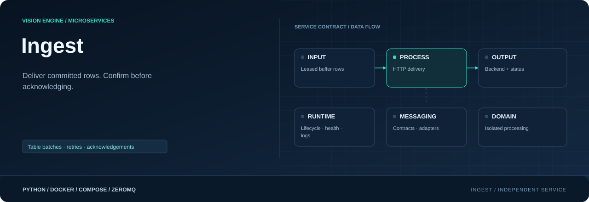
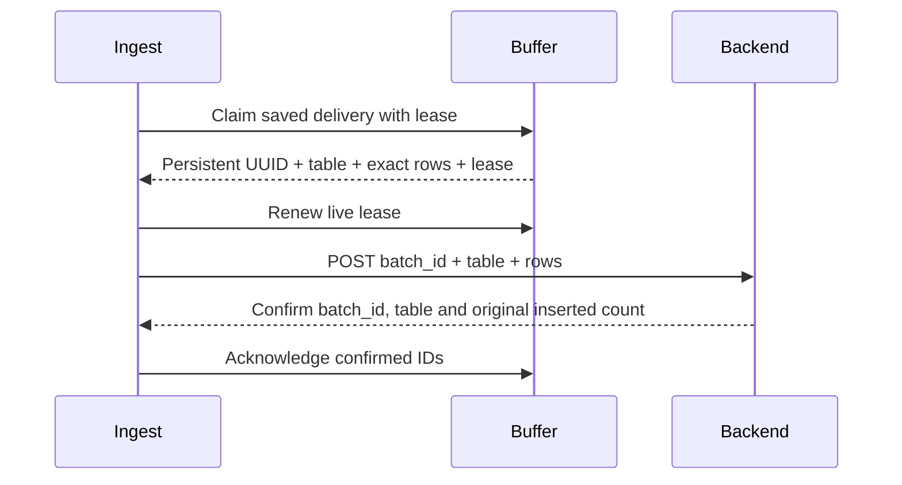

<div align="center">



**Deliver committed rows to the backend. Acknowledge confirmed inserts.**

[](requirements.txt)
[](Dockerfile)
[](#responsibility)

[Project](../../README.md) · [Services](../README.md) · [Configuration](../../config/README.md) · [Handbook](../../docs/README.md)

</div>

## Responsibility

| Property | Value |
|---|---|
| Instance scope | One shared worker |
| Input | Leased buffer.delivery.v1 with persistent UUIDv4 |
| Output | HTTP table batches + status |
| Image | `visionengine-ingest:local` |
| Generated file | `config/.generated/ingest.compose.yaml` |
| Entry point | `python -m services.ingest` |

## Delivery flow

Ingest requests one saved delivery through buffer RPC (`claim_delivery`). Buffer
owns its UUIDv4, destination table and exact ordered rows. Ingest POSTs that
delivery unchanged and acknowledges its complete row list only after matching
backend confirmation. It creates no UUIDs, separate database or persistence
volume; buffer remains the durable owner.



## HTTP contract

```http
POST <api.url>/branches/ingest
X-API-Key: <api.key>
Content-Type: application/json

{"batch_id":"9fcf4c84-55ca-4b67-94ac-61f434a893e2","table":"notifications","rows":[{"rule_name":"entrance_alert","severity":"warning"}]}
```

The body illustrates shape; actual rows have row-builder fields. Backend key
selects the branch; branch ID is not added to this body. Confirmation requires
HTTP 200/201, `success: true`, a matching `data.batch_id` and `data.table`, and an
integer `data.inserted` equal to the delivery row count. Example confirmation:

```json
{"success":true,"data":{"batch_id":"9fcf4c84-55ca-4b67-94ac-61f434a893e2","table":"notifications","inserted":1}}
```

The backend must atomically store its receipt and destination rows. On an
identical retry it returns the same UUID, table and original confirmed row count,
even though it inserts no new rows. An additional `duplicate: true` field is
allowed but is not required by ingest. A mismatched payload for an existing ID
must be rejected by the backend. Empty/malformed/missing-ID/wrong-count responses,
timeouts and rejected requests leave the delivery unconfirmed. There is no
fallback to unidentified legacy requests.

`api.ingest` controls batching/flush cadence. `api.request` controls timeout and
failure-warning threshold; `api.buffer.retry_interval_seconds` supplies backoff
base, multiplied 1, 2, 4, then capped at 5. Warning threshold does not discard work.
Responses are bounded to 64 KiB; redirects are rejected. Logs omit credentials,
backend URLs, row bodies and raw response bodies.

## Batch ID conflicts

Only HTTP 409 with `success: false` and `error.code: "BATCH_ID_CONFLICT"` pauses
all automatic backend delivery. Ingest releases the temporary lease, retains the
saved delivery and its rows, and logs the UUID/table/count without payloads.
It never acknowledges the rejected rows or generates a replacement delivery ID.

The worker remains alive with fresh heartbeats in `state: "blocked"`; snapshots
and published status include `blocked_batch_id` and
`dependency_error: "batch_id_conflict"`. Pending counts are unknown while paused
because the worker no longer polls/claims work. The existing healthcheck reports
this state unhealthy, so operator attention is visible. The worker does not exit
or start a retry loop. Other HTTP 409 codes and temporary errors retain the
existing retry/backoff behavior. Matching duplicate receipts still return 200
and complete normally.

This minimal pause is held in memory until ingest restarts. A restart attempts
the saved delivery again and pauses again if the conflict remains. Investigate
the saved UUID/content and backend receipt before resuming. No buffer schema or
per-batch quarantine is added by this handling; all backend delivery pauses.

## Recovery and delivery limits

Live leases renew before HTTP requests. ACK loss retries the same ACK before new
HTTP, avoiding repost merely because a live worker missed a buffer response.
Failed deliveries are released for retry; their saved UUID and membership remain.
A killed worker's leases expire. Buffer restart/lease recovery returns the same
delivery, including when the backend committed before the worker died. New rows
are never merged into that retry. Stop finishes the bounded active request/ACK
attempt and releases unsent work; it does not drain the entire backlog.

> [!IMPORTANT]
> Deploy the receipt-aware backend first, then the updated buffer, then ingest.
> The backend must enforce uniqueness on `(branch_id, batch_id)` and retain receipts
> for as long as a delivery can be retried. The client still makes at-least-once
> attempts; backend receipts prevent repeat inserts. An older backend may insert
> rows while omitting the required UUID confirmation, causing repeated requests.
> Do not point this ingest at that older API. Smaller batch/byte limits must still
> accommodate saved deliveries; buffer refuses to split an existing delivery.

`ambiguous_rows_total` reports observed uncertainty, not every actual duplicate.
Buffer capacity handling still applies during long outages.

## Run and inspect

```console
python -m config.controller --generate
docker compose -f config/.generated/pipeline.compose.yaml up --build -d visionengine-ingest-service
docker compose -f config/.generated/pipeline.compose.yaml logs -f --tail 20 visionengine-ingest-service
docker compose -f config/.generated/pipeline.compose.yaml exec visionengine-ingest-service python -m services.ingest.tools.receiver --connect tcp://127.0.0.1:5566 --device-id node-01 --count 5 --format json
```

Input is `tcp://visionengine-buffer-service:5564` in Compose. Status topic is
`ingest.status.v1/<device_id>`, container 5566 / host 16000. It reports counts,
backlog, HTTP duration/status, failures and ambiguity, not actual row batches.
Original `api.yaml`/`device.yaml` are mounted read-only. Starting this service
can immediately send already-buffered rows to the configured backend.

Install `services/ingest/requirements.txt` and use `python -m services.ingest --help`
for native execution. Health checks worker liveness, including retry loops;
monitor separately reports backend dependency failures. A backend outage should
retain queued work rather than force a container restart loop.

## Source map

| Location | Responsibility |
|---|---|
| [__main__.py](__main__.py) | Module entry point |
| [Dockerfile](Dockerfile) | Image layers, packaged code, entry point and healthcheck |
| [requirements.txt](requirements.txt) | Runtime dependencies |
| `messaging/` | Service-local wire contracts, validation and input/output adapters: [backend.py](messaging/backend.py), [buffer.py](messaging/buffer.py), [publisher.py](messaging/publisher.py) |
| `processing/` | Domain logic, bounded work queues and worker state: [worker.py](processing/worker.py) |
| `runtime/` | Configuration, CLI lifecycle, logging and independent healthcheck: [configuration.py](runtime/configuration.py), [healthcheck.py](runtime/healthcheck.py), [logging.py](runtime/logging.py), [service.py](runtime/service.py) |
| `tools/` | Diagnostic receivers and inspection utilities: [receiver.py](tools/receiver.py) |

## Operating notes

Run commands from the repository root. Use IDs from your installation; examples
use camera `entrance`, model `people` and device `node-01`. Host ports can change
with generated instance order; the umbrella endpoint maps are authoritative.

[Update only this image](../../docs/UPDATES.md) · [Inspect connections](../../docs/OBSERVABILITY.md) · [Storage and recovery](../../docs/STORAGE.md)
