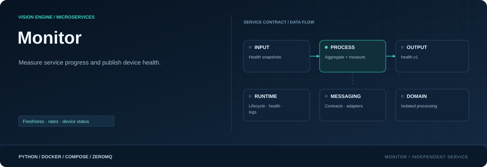

<div align="center">



**Measure services. Aggregate device health. Publish metadata.**

[](requirements.txt)
[](Dockerfile)
[](#responsibility)

[Project](../../README.md) · [Services](../README.md) · [Configuration](../../config/README.md) · [Handbook](../../docs/README.md)

</div>

## Responsibility

| Property | Value |
|---|---|
| Instance scope | One per device |
| Input | Shared service health snapshots |
| Output | health.v1 metadata |
| Image | `visionengine-monitor:local` |
| Generated file | `config/.generated/monitor.compose.yaml` |
| Entry point | `python -m services.monitor` |

## Measurement ownership

Monitor reads service snapshots and aggregates device state. Row builder alone
maps this metadata into a `nodes` row; buffer persists it and ingest sends it.
No Docker socket, database row construction or model inference runs here.

It checks recent heartbeat/state/progress, per-camera dependencies and accepted
rules totals. Missing, stale, malformed or failed evidence affects health. Per-camera
rules progress can be unhealthy even if other cameras keep the shared service busy.
Accepted counts are rule-approved objects, not raw model detections.

## Snapshot transport and metrics

Generated services write unique `/health/<compose-service>.json` paths into
`health_snapshots`. Monitor mounts this volume read-only. Compose supplies
`--watch SERVICE=PATH`, `--camera-stage CAMERA=SERVICE`,
`--camera-counter CAMERA=RULES_SERVICE` and the buffer source. Its own liveness
file is separate. No extra monitor YAML is needed; device/camera settings supply
identity and publication cadence.

Counters/rates and original queue/drop/timing metrics appear under
`health.services`. Rates compare sampled counter deltas. Accepted totals account
for observed rules restarts during the monitor session; a monitor restart resets
its in-memory history. Unseen increments cannot be reconstructed.

Buffer backlog includes leased unsent work. Missing snapshot reports
`buffer: {available: false, pending: null}` rather than zero. Missing counters are
explicitly unavailable; retained totals are a lower bound.

## Published device health

Output `health.v1/<device_id>` is topic + JSON, maximum 1 MiB, container 5563 / host
13000. Envelope contains device ID, monitor stream/sequence, receipt timestamp
and aggregate `health`: identity, overall `ok`/`degraded`/`error`, camera counts,
accepted totals, buffer state, uptime and UTC timestamp.

Publication follows `device.heartbeat.interval_seconds`; sources are normally
sampled every five seconds. Metadata still publishes when database heartbeat is
disabled; row builder honors that enabled flag before emitting node rows.
Optional `device.health_file` writes an aggregate report at its configured cadence,
with `monitor_reports` persistence in Compose when enabled. Snapshots overwrite;
they are not an append-only history.

## Run and inspect

```console
python -m config.controller --generate
docker compose -f config/.generated/pipeline.compose.yaml up --build -d visionengine-monitor-service
docker compose -f config/.generated/pipeline.compose.yaml exec visionengine-monitor-service python -m services.monitor.tools.receiver --connect tcp://127.0.0.1:5563 --device-id node-01 --count 5 --format json
```

Install `services/monitor/requirements.txt` and use
`python -m services.monitor --help` for native watch-path arguments. Monitor has
no startup dependencies, so observing downstream services cannot create a Compose
dependency cycle.

## Interpret health correctly

A healthy monitor process can report an unhealthy device. Its own healthcheck
checks monitor liveness, not universal camera health. Freshness/progress default
is 30 seconds; recently stopped services can look fresh until evidence expires.
Snapshots do not prove process existence between samples, network reachability,
every-message delivery, GPU utilization or tracking accuracy. Remote service
monitoring needs network telemetry; shared local files are the implemented input.

## Source map

| Location | Responsibility |
|---|---|
| [__main__.py](__main__.py) | Module entry point |
| [Dockerfile](Dockerfile) | Image layers, packaged code, entry point and healthcheck |
| [requirements.txt](requirements.txt) | Runtime dependencies |
| `messaging/` | Service-local wire contracts, validation and input/output adapters: [health.py](messaging/health.py), [publisher.py](messaging/publisher.py) |
| `processing/` | Domain logic, bounded work queues and worker state: [collector.py](processing/collector.py) |
| `runtime/` | Configuration, CLI lifecycle, logging and independent healthcheck: [configuration.py](runtime/configuration.py), [healthcheck.py](runtime/healthcheck.py), [logging.py](runtime/logging.py), [service.py](runtime/service.py) |
| `tools/` | Diagnostic receivers and inspection utilities: [receiver.py](tools/receiver.py) |

## Operating notes

Run commands from the repository root. Use IDs from your installation; examples
use camera `entrance`, model `people` and device `node-01`. Host ports can change
with generated instance order; the umbrella endpoint maps are authoritative.

[Update only this image](../../docs/UPDATES.md) · [Inspect connections](../../docs/OBSERVABILITY.md) · [Storage and recovery](../../docs/STORAGE.md)
