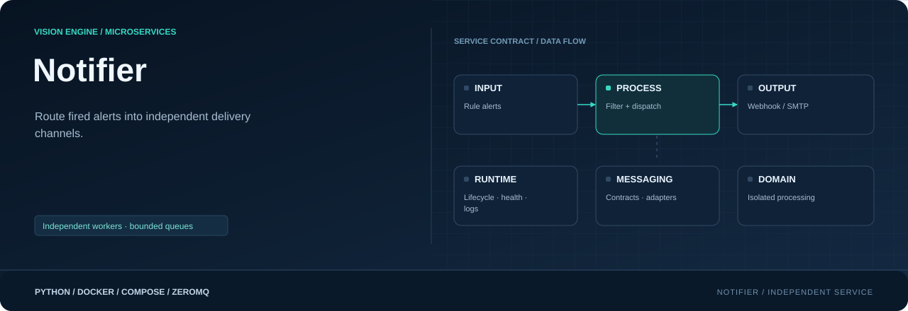
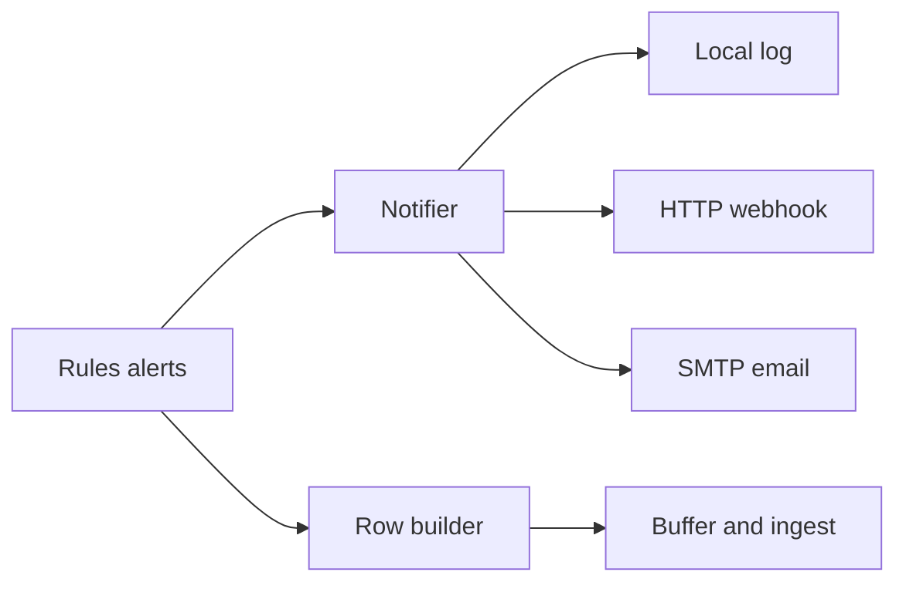

<div align="center">



**Route fired alerts to independent webhook and email channels.**

[](requirements.txt)
[](Dockerfile)
[](#responsibility)

[Project](../../README.md) · [Services](../README.md) · [Configuration](../../config/README.md) · [Handbook](../../docs/README.md)

</div>

## Responsibility

| Property | Value |
|---|---|
| Instance scope | One shared instance when enabled |
| Input | Rules alert.v1 |
| Output | Webhook / SMTP / Resend / log + status |
| Image | `visionengine-notifier:local` |
| Generated file | `config/.generated/notifier.compose.yaml` |
| Entry point | `python -m services.notifier` |

## Alerts and channel ownership

Rules owns matching, zones, UTC schedules and cooldowns. Notifier receives already
fired alerts and applies channel rule/severity filters before sending. It never
creates database rows. Notification-table selection is independent: a null table
can still allow live delivery. Row builder/buffer/ingest persist database rows.



A webhook is an HTTP POST. The VisionEngine backend's webhook can broadcast to
its frontend WebSocket clients; notifier itself is not a WebSocket server or
video-streaming gateway. The legacy Edge log/webhook behavior is retained with
additional SMTP and bounded/isolated channel workers.

## Configuration

`notifications.yaml` owns channels; `api.yaml` and `device.yaml` supply identity
and API-key auth. Missing `emails` stays compatible; `emails: []` disables email.
Full annotated examples are in
[notifications.sample.yaml](../../config/config_sample/notifications.sample.yaml).

```yaml
notifications:
  log:
    enabled: true
  webhooks: []
  emails:
    - name: security_email
      enabled: false  # Configure the provider and secret before enabling.
      smtp:
        host: smtp.example.com
        port: 587
        security: starttls
        username: alerts@example.com
        password_env: VISIONENGINE_SMTP_PASSWORD
      from: alerts@example.com
      to: [security@example.com]
      subject_prefix: "[VisionEngine]"
      timeout_seconds: 10
      rules: "*"
      severities: [warning, critical]
```

Rule and severity filters are AND-ed; `"*"` means all. Names are unique across
webhooks/emails; maximum 64 delivery channels, 1..50 unique recipients per email.
For webhooks, `auth: api_key` adds the existing X-API-Key; `auth: none` omits it.

SMTP uses `starttls` for TLS upgrade (commonly 587), `ssl` for TLS from connection
start (commonly 465), or `none` for an unauthenticated local relay. Certificates are
verified. Login requires TLS. Set username/password_env null for no login. OAuth2
token management is not implemented; provider login/sender policy must permit it.

`password_env` names a runtime secret, never a literal generated password.
An enabled channel requires it before Compose reads its generated variable reference:

```powershell
$env:VISIONENGINE_SMTP_PASSWORD = "your-provider-password"
```

Use a private explicit `--env-file .env` if preferred. Do not commit secrets or
publish interpolated Compose output containing them. Regenerate after changing
channel enablement/secret variable names. SMTP email is plain text with a summary and
alert JSON; safe headers and bounded subject lines avoid newline/header injection.

## Resend published templates

```yaml
notifications:
  log:
    enabled: true
  webhooks: []  # Keep existing webhook entries if needed.
  emails:
    - name: home_lab_email
      enabled: true
      provider: resend
      api_key_env: RESEND_API_KEY
      template_id: "d0821d80-78ab-4b47-9b1c-22011327459d"
      from: "Vision Engine <notifications@visionengine.evalholding.com>"
      to:
        - osamaandwajeeh@gmail.com
      timeout_seconds: 10
      rules: "*"
      severities: "*"
```

`from` supports a display name; `to` is a list of plain email addresses.
SMTP also accepts `from`; legacy SMTP `from_address` remains supported, but
specifying both is rejected. Omitting `provider` retains SMTP behavior.
Resend entries reject SMTP-only keys. Disabled channels need valid settings,
but do not require runtime secrets. No API key is stored in generated YAML.

Put `RESEND_API_KEY=your-send-only-key` in a Git-ignored `.env` at the repository
root. Run from that root, after publishing the template and verifying its sender:

```console
python -m config.controller --generate
docker compose --env-file .env -f config/.generated/pipeline.compose.yaml config --quiet
docker compose --env-file .env -f config/.generated/pipeline.compose.yaml up --build -d visionengine-notifier-service
docker compose --env-file .env -f config/.generated/pipeline.compose.yaml logs -f --tail 20 visionengine-notifier-service
```

The generator passes each enabled channel's named secret. Missing secrets fail
at Compose evaluation and direct-service startup. Exported environment variables
also work. Never print interpolated Compose output containing secrets.

| Variable | Source |
|---|---|
| `MESSAGE` | Rendered rule alert message |
| `SEVERITY` | Rule severity |
| `SEVERITY_COLOR` | info: green `#15803d`; warning: amber `#b54708`; critical: red `#b42318` |
| `BRANCH_NAME` | `device.yaml` → `device.location` |
| `CAMERA_NAME` | Alert camera name |
| `RULE_NAME` | Matched rule name |
| `ZONE` | Alert zone |
| `CAPTURED_AT` | Capture timestamp normalized to UTC |
| `EVENT_REFERENCE` | Rules-generated `alert_id` |

Mapping is explicit, not discovered from the template ID. Template variable names
must match these keys; the API key needs sending permission only. Resend provides
the published subject/design, so `subject_prefix` does not apply. Strings over
the provider's 2,000-character variable limit fail locally. Media is not implemented.

Rules adds `alert_id` per emitted alert; notifier carries it into email template
variables. The existing backend webhook schema stays unchanged. With older rules images, notifier derives a deterministic reference
from the batch and alert. Database columns are unchanged: notification rows do
not automatically store the new ID.

Resend uses HTTPS, certificate verification, a total timeout, no redirects, and
an idempotency key per alert/channel/template/recipient set. Existing bounded
workers, rule filters and cooldown behavior remain. No retry is added. HTTP
429/authentication/template errors are counted as failures. Acceptance by Resend
is not proof of inbox delivery. Response bodies and keys are not logged. Check
Resend email activity for delivery, bounce and suppression details.

[Resend sending API](https://resend.com/docs/api-reference/emails/send-email) ·
[Template variables](https://resend.com/docs/dashboard/templates/template-variables)

## Payload, queues and success semantics

Webhook payloads preserve branch/device, rule/severity/message, track/class/confidence,
model/camera, zone, integer corners, anchors/norms, frame size, capture timestamp
and nonempty nested attributes. API key is a header, not payload data.

Input defaults: 32 batches / 4 MiB / five seconds. Each destination has its own
bounded queue and asynchronous worker: 256 alerts / 4 MiB / 30 seconds. Old/expired
work drops with counters. A slow channel does not block another; task count is
bounded by channel count, not one unbounded task per alert. Recent batch dedup
history is bounded to 4096 and resets on restart. No second cooldown is added.

> [!IMPORTANT]
> Delivery is live best effort: one attempt per selected channel, no retry or
> persistence. HTTP success means 2xx; redirects are not followed. SMTP success
> means acceptance for all recipients, not proof of inbox arrival. Partial
> recipient acceptance is reported and not retried.

Requests have deadlines and logs omit raw responses/errors, credentials and URLs.
Stop drains pending sends for at most ten seconds by default, then cancels/counts
remaining work; Docker grace period is 15 seconds. Database notifications can
remain durable even if live notification delivery failed.

## Run and inspect

```console
python -m config.controller --generate
docker compose -f config/.generated/pipeline.compose.yaml up --build -d visionengine-notifier-service
docker compose -f config/.generated/pipeline.compose.yaml logs -f --tail 20 visionengine-notifier-service
docker compose -f config/.generated/pipeline.compose.yaml exec visionengine-notifier-service python -m services.notifier.tools.receiver --connect tcp://127.0.0.1:5567 --device-id node-01 --count 5 --format json
```

Status is `notifier.status.v1/<device_id>`, container 5567 / host 17000. It exposes
queue/send/failure state rather than replaying alert payloads. Service liveness
can be healthy while a destination is failing; monitor reports dependency state.
Install `services/notifier/requirements.txt` and run
`python -m services.notifier --help` for direct execution.

## Source map

| Location | Responsibility |
|---|---|
| [__main__.py](__main__.py) | Module entry point |
| [Dockerfile](Dockerfile) | Image layers, packaged code, entry point and healthcheck |
| [requirements.txt](requirements.txt) | Runtime dependencies |
| `messaging/` | Service-local wire contracts, validation and input/output adapters: [alerts.py](messaging/alerts.py), [channels.py](messaging/channels.py), [resend.py](messaging/resend.py), [detections.py](messaging/detections.py), [events.py](messaging/events.py), [publisher.py](messaging/publisher.py) |
| `processing/` | Domain logic, bounded work queues and worker state: [payload.py](processing/payload.py), [queue.py](processing/queue.py), [worker.py](processing/worker.py) |
| `runtime/` | Configuration, CLI lifecycle, logging and independent healthcheck: [configuration.py](runtime/configuration.py), [healthcheck.py](runtime/healthcheck.py), [logging.py](runtime/logging.py), [service.py](runtime/service.py) |
| `tools/` | Diagnostic receivers and inspection utilities: [receiver.py](tools/receiver.py) |

## Operating notes

Run commands from the repository root. Use IDs from your installation; examples
use camera `entrance`, model `people` and device `node-01`. Host ports can change
with generated instance order; the umbrella endpoint maps are authoritative.

[Update only this image](../../docs/UPDATES.md) · [Inspect connections](../../docs/OBSERVABILITY.md) · [Storage and recovery](../../docs/STORAGE.md)
