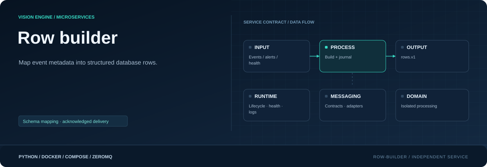

<div align="center">



**One place maps pipeline metadata into database rows.**

[](requirements.txt)
[](Dockerfile)
[](#responsibility)

[Project](../../README.md) · [Services](../README.md) · [Configuration](../../config/README.md) · [Handbook](../../docs/README.md)

</div>

## Responsibility

| Property | Value |
|---|---|
| Instance scope | One shared instance |
| Input | Accepted events, alerts, health |
| Output | rows.v1 + durable delivery |
| Image | `visionengine-row-builder:local` |
| Generated file | `config/.generated/row_builder.compose.yaml` |
| Entry point | `python -m services.row_builder` |

## Structured row ownership

This is the only stage mapping pipeline metadata into backend table rows. It
consumes accepted `event.v1`, fired `alert.v1`, and monitor `health.v1` separately.
It does not evaluate rules, send notifications or contact the backend.

| Input | Mapping | Destination |
|---|---|---|
| Accepted event | Original detection fields, geometry, context and route | Camera detection table/routing |
| Fired alert | Rule name, severity, message and associated detection | Rule `notifications_table`, unless null |
| Device health | Identity, status, camera counts, detection totals, backlog, uptime, timestamp | `device.heartbeat.table`, when enabled |

Alert rows are a decision-specific subset; not every event is an alert. Multiple
rule alerts can make multiple notification rows. Camera routing can skip a
class/table. Disabled heartbeat skips node rows. `buffer_pending: null` represents
an unavailable measurement, not an empty buffer.

Output envelope is `rows.v1`, preserving input identity and `source_type`, with
`rows: [{table, row}]` and row-builder timing/counts. Camera topics are
`rows.v1/<camera_id>`; device rows use `rows.v1/device/<device_id>`. Empty outputs
are valid when input is empty or mapping is disabled/skipped.

## Durable and diagnostic outputs

The PUB on container 5562 / host 12000 is observational. Generated deployments
also configure `--buffer-connect` for acknowledged delivery. Every nonempty batch
is committed synchronously to a separate SQLite producer journal, using WAL and
`synchronous=FULL`, before diagnostic publishing. A background delivery thread
retries the stable batch ID until buffer confirms its own durable commit, then
removes the journal entry. Backend HTTP delivery happens later in ingest; the
builder does not wait for that response.
Volume `delivery_row_builder` mounts at `/delivery`, with `/delivery/pending.db`.
Row builder never opens buffer's own database.

The journal is bounded by graph row limits (currently 1000 batches / 4 MiB).
When full, row building blocks without discarding already journaled batches.
Earlier live input queues can still overflow. Restart preserves pending journal
entries. Empty batches are visible but not journaled or stored. Buffer receipt
retention defines how long retry deduplication is guaranteed.

## Notification-based scheduling

Input reception, row building and journal delivery use separate threads. Condition
notifications wake them when work or journal space becomes available:

| Waiting work | Wakeup signal | Ordering guarantee |
|---|---|---|
| Row builder waiting for input | Reception queues a batch in the shared inbox | Existing round-robin input scheduling and sequence fencing remain in place |
| Delivery waiting for journal data | A nonempty batch finishes its journal commit | Delivery reads committed batches in journal order |
| Builder waiting for journal capacity | Buffer confirms storage and journal deletion commits | Capacity is checked again before appending more work |

These notifications replace the 10 ms inbox idle polling and 50 ms journal
work/space polling. A 100 ms timed condition wait remains to check the separate
shutdown event; newly available work or space signals the waiter immediately.
Normal thread scheduling, locks, serialization, storage and RPC still add latency.
The configured buffer retry backoff remains unchanged.

Journal appends still run synchronously in the build loop. There is no additional
RAM staging queue or asynchronous journal writer. Restart recovery, stable batch
IDs and durable-before-publish behavior remain unchanged.

Wakeups reduce avoidable idle delay and resume work sooner after temporary
backpressure. They do not increase queue capacity or guarantee higher sustained
FPS. Larger queues absorb finite bursts; sustained input above processing or
ingest delivery capacity still accumulates work and can eventually drop live input.

## Run and inspect

```console
python -m config.controller --generate
docker compose -f config/.generated/pipeline.compose.yaml up --build -d visionengine-row-builder-service
docker compose -f config/.generated/pipeline.compose.yaml exec visionengine-row-builder-service python -m services.row_builder.tools.receiver --connect tcp://127.0.0.1:5562 --camera-id entrance --count 10 --format json
docker compose -f config/.generated/pipeline.compose.yaml exec visionengine-row-builder-service python -m services.row_builder.tools.receiver --connect tcp://127.0.0.1:5562 --device-id node-01 --count 5 --format json
```

Configuration comes from camera/model/rule settings plus device identity for
monitor input. Direct execution can use explicit accepted/alert publishers:

```console
python -m pip install -r services/row_builder/requirements.txt
python -m services.row_builder --events-input tcp://127.0.0.1:10000 --alerts-input tcp://127.0.0.1:11000
```

Add `--monitor-input` for device health. At least accepted-event or monitor input
is required. The direct example has no durable buffer connection unless you add it.

## Queues and contracts

Queue limits apply to configured input endpoints, not individually to cameras.
For example, cameras sharing one accepted-event endpoint share its queue; alerts
and monitor health have their own configured input queues.

| Storage | Default item limit | Default byte limit | Age / overflow behavior | CLI controls |
|---|---|---|---|---|
| Each input endpoint queue | 32 batches | 4 MiB | Five-second age limit; drop oldest on overflow | `--max-items`, `--max-bytes`, `--max-age-ms` |
| Shared durable producer journal | 1000 batches | 4 MiB | No age expiry; block new appends when full | `--delivery-max-items`, `--delivery-max-bytes` |

Both item and byte limits apply: a large batch can exhaust the byte budget before
the item limit is reached. Input byte accounting measures serialized message size;
decoded Python objects and separate ZeroMQ queues consume additional memory.
Increasing the inbox does not recover messages already dropped by PUB/SUB.

Duplicate fencing includes input channel plus camera, so alert and event sharing
a sequence do not suppress each other. Health payload limit is 1 MiB, event 8 MiB,
alert 16 MiB, rows 16 MiB; queues can be smaller. Logs expose skips, drops, build
latency and per-row-kind counts. Generated health lives on shared `/health`.

A brief `buffer_wait` state also occurs during normal durable appends. Investigate
sustained waits alongside input `dropped_total`, journal `pending_batches` /
`pending_bytes`, `acked_batches` progress and `retries`. An empty journal with a
growing buffer backlog points to a later delivery stage; wakeups alone cannot
resolve that backlog. Row-mapping timing does not include journal or buffer-RPC
waiting time.

## Source map

| Location | Responsibility |
|---|---|
| [__main__.py](__main__.py) | Module entry point |
| [Dockerfile](Dockerfile) | Image layers, packaged code, entry point and healthcheck |
| [requirements.txt](requirements.txt) | Runtime dependencies |
| `messaging/` | Service-local wire contracts, validation and input/output adapters: [alerts.py](messaging/alerts.py), [buffer.py](messaging/buffer.py), [detections.py](messaging/detections.py), [events.py](messaging/events.py), [health.py](messaging/health.py), [publisher.py](messaging/publisher.py), [rows.py](messaging/rows.py), [subscriber.py](messaging/subscriber.py) |
| `processing/` | Row mapping, bounded input queues, notification wakeups and worker state: [builder.py](processing/builder.py), [worker.py](processing/worker.py) |
| `runtime/` | Durable journal, notification-based delivery, configuration, lifecycle, logging and healthcheck: [configuration.py](runtime/configuration.py), [delivery.py](runtime/delivery.py), [healthcheck.py](runtime/healthcheck.py), [logging.py](runtime/logging.py), [service.py](runtime/service.py) |
| `tools/` | Diagnostic receivers and inspection utilities: [receiver.py](tools/receiver.py) |

## Operating notes

Run commands from the repository root. Use IDs from your installation; examples
use camera `entrance`, model `people` and device `node-01`. Host ports can change
with generated instance order; the umbrella endpoint maps are authoritative.

[Update only this image](../../docs/UPDATES.md) · [Inspect connections](../../docs/OBSERVABILITY.md) · [Storage and recovery](../../docs/STORAGE.md)
