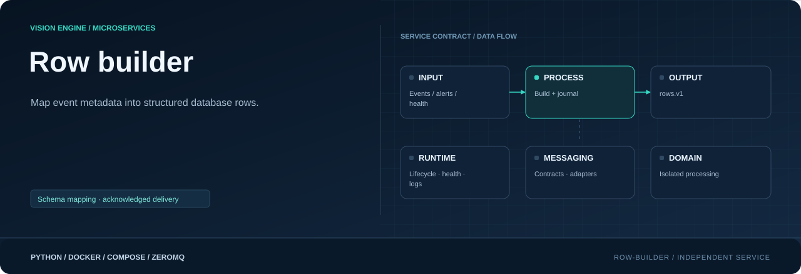

<div align="center">



**One place maps pipeline metadata into database rows.**

[](requirements.txt)
[](Dockerfile)
[](#responsibility)

[Project](../../README.md) · [Services](../README.md) · [Configuration](../../config/README.md) · [Handbook](../../docs/README.md)

</div>

## Responsibility

| Property | Value |
|---|---|
| Instance scope | One shared instance |
| Input | Accepted events, alerts, health |
| Output | rows.v1 + durable delivery |
| Image | `visionengine-row-builder:local` |
| Generated file | `config/.generated/row_builder.compose.yaml` |
| Entry point | `python -m services.row_builder` |

## Structured row ownership

This is the only stage mapping pipeline metadata into backend table rows. It
consumes accepted `event.v1`, fired `alert.v1`, and monitor `health.v1` separately.
It does not evaluate rules, send notifications or contact the backend.

| Input | Mapping | Destination |
|---|---|---|
| Accepted event | Original detection fields, geometry, context and route | Camera detection table/routing |
| Fired alert | Rule name, severity, message and associated detection | Rule `notifications_table`, unless null |
| Device health | Identity, status, camera counts, detection totals, backlog, uptime, timestamp | `device.heartbeat.table`, when enabled |

Alert rows are a decision-specific subset; not every event is an alert. Multiple
rule alerts can make multiple notification rows. Camera routing can skip a
class/table. Disabled heartbeat skips node rows. `buffer_pending: null` represents
an unavailable measurement, not an empty buffer.

Output envelope is `rows.v1`, preserving input identity and `source_type`, with
`rows: [{table, row}]` and row-builder timing/counts. Camera topics are
`rows.v1/<camera_id>`; device rows use `rows.v1/device/<device_id>`. Empty outputs
are valid when input is empty or mapping is disabled/skipped.

## Durable and diagnostic outputs

The generated service uses a single SQLite database at `/delivery/pending.db`
on the `delivery_row_builder` volume. Delivery proceeds in three steps.

1. The subscriber validates each event, alert or health message and commits its
   original JSON bytes to `incoming`. Messages ready in the same socket poll
   share a commit. The subscriber never waits to fill a group.
2. The worker reads inputs in receipt order and builds rows outside a database
   transaction. One transaction inserts the exact nonempty output into `pending`,
   records the input sequence and removes the input. A failure rolls back these
   operations together. Empty or intentionally skipped outputs consume no buffer
   sequence. Diagnostic PUB on container 5562 / host 12000 follows the commit.
3. The delivery thread sends the saved output and retries with the same UUID,
   producer sequence and digest until the buffer confirms its durable commit.
   Deletion of the output and advancement of its retirement checkpoint are atomic.
   Backend delivery happens later in ingest.

The subscriber has its own SQLite connection. WAL permits simultaneous reads and
writes. FULL synchronization covers both input and output commits. SQLite
serializes write transactions. Row mapping and buffer RPC run outside them.

Existing journals from the current buffer protocol acquire the inbox tables on
startup and continue draining saved outputs with their original identities.
Preserve the journal volume and buffer database across upgrades. Before reverting
to an older row-builder image, drain the durable inbox; older versions only read
`pending`. [Buffer storage and recovery](../buffer/README.md)

## Run and inspect

```console
python -m config.controller --generate
docker compose -f config/.generated/pipeline.compose.yaml up --build -d visionengine-row-builder-service
docker compose -f config/.generated/pipeline.compose.yaml exec visionengine-row-builder-service python -m services.row_builder.tools.receiver --connect tcp://127.0.0.1:5562 --camera-id entrance --count 10 --format json
docker compose -f config/.generated/pipeline.compose.yaml exec visionengine-row-builder-service python -m services.row_builder.tools.receiver --connect tcp://127.0.0.1:5562 --device-id node-01 --count 5 --format json
```

Configuration comes from camera/model/rule settings plus device identity for
monitor input. Direct execution can use explicit accepted/alert publishers:

```console
python -m pip install -r services/row_builder/requirements.txt
python -m services.row_builder --events-input tcp://127.0.0.1:10000 --alerts-input tcp://127.0.0.1:11000
```

Add `--monitor-input` for device health. At least accepted-event or monitor input
is required. The direct example has no durable buffer connection unless you add it.

## Queues and contracts

| Stage | Default limit | Behavior at the limit |
|---|---|---|
| ZeroMQ receive socket | 32 messages per endpoint (`--max-items`) | PUB/SUB can lose messages before input commits. |
| Shared `incoming` inbox with buffer delivery | 100 MiB of serialized input (`--inbox-max-bytes`) | Intake waits for space. Committed inputs have no age expiry or overflow eviction. |
| Shared send-ready `pending` journal | 1000 batches / 4 MiB (`--delivery-max-items`, `--delivery-max-bytes`) | Worker waits while delivery continues. |
| Diagnostic-only run without `--buffer-connect` | 32 batches / 4 MiB / 5 seconds per input | Original in-memory queues use `--max-items`, `--max-bytes` and `--max-age-ms`. |

The 100 MiB budget measures live input payloads. Disk use also includes send-ready
rows, SQLite pages, indexes and the WAL. Deleted pages can be reused.
A single message larger than the configured inbox limit cannot be admitted.

In durable mode, per-input `received_total` counts committed inputs this run.
`queued_batches` and `queued_bytes` include unprocessed inputs from earlier runs.
`capacity_wait` marks intake waiting for space. Input `dropped_total` counts
application evictions only and cannot detect upstream PUB/SUB loss.
Delivery `pending_batches` and `pending_bytes` measure send-ready outputs only.
Compare these with acknowledgments and retries to see which stage is backing up.

Event and alert batches sharing a frame sequence are tracked independently.
Health payloads are limited to 1 MiB, events to 8 MiB, alerts and rows to
16 MiB. `batches_per_second` counts processed input batches. Row mapping
time excludes journal and RPC waits. Health snapshots are written to `/health`.

## Source map

| Location | Responsibility |
|---|---|
| [__main__.py](__main__.py) | Module entry point |
| [Dockerfile](Dockerfile) | Image layers, packaged code, entry point and healthcheck |
| [requirements.txt](requirements.txt) | Runtime dependencies |
| `messaging/` | Service-local wire contracts, validation and input/output adapters: [alerts.py](messaging/alerts.py), [buffer.py](messaging/buffer.py), [detections.py](messaging/detections.py), [events.py](messaging/events.py), [health.py](messaging/health.py), [publisher.py](messaging/publisher.py), [rows.py](messaging/rows.py), [subscriber.py](messaging/subscriber.py) |
| `processing/` | Row mapping, diagnostic input queues, sequence checks and worker state: [builder.py](processing/builder.py), [worker.py](processing/worker.py) |
| `runtime/` | Durable inbox, journal and acknowledged delivery, configuration, lifecycle, logging and healthcheck: [configuration.py](runtime/configuration.py), [inbox.py](runtime/inbox.py), [delivery.py](runtime/delivery.py), [healthcheck.py](runtime/healthcheck.py), [logging.py](runtime/logging.py), [service.py](runtime/service.py) |
| `tools/` | Diagnostic receivers and inspection utilities: [receiver.py](tools/receiver.py) |

## Operating notes

Run commands from the repository root. Use IDs from your installation; examples
use camera `entrance`, model `people` and device `node-01`. Host ports can change
with generated instance order; the umbrella endpoint maps are authoritative.

[Update only this image](../../docs/UPDATES.md) · [Inspect connections](../../docs/OBSERVABILITY.md) · [Storage and recovery](../../docs/STORAGE.md)
