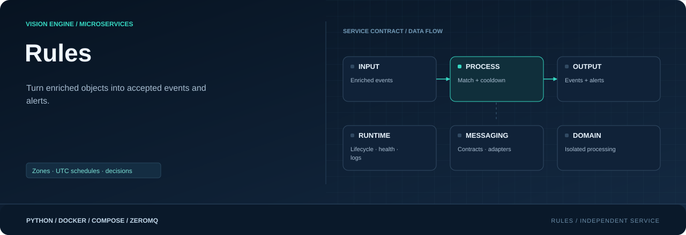

<div align="center">



**Turn enriched objects into accepted events and fired alerts.**

[](requirements.txt)
[](Dockerfile)
[](#responsibility)

[Project](../../README.md) · [Services](../README.md) · [Configuration](../../config/README.md) · [Handbook](../../docs/README.md)

</div>

## Responsibility

| Property | Value |
|---|---|
| Instance scope | One shared rules instance |
| Input | Enriched event.v1 batches |
| Output | Accepted events + alerts |
| Image | `visionengine-rules:local` |
| Generated file | `config/.generated/rules.compose.yaml` |
| Entry point | `python -m services.rules` |

## Rule decisions

Rules owns zones, camera/class/zone/confidence matching, UTC schedules, cooldowns,
severity and messages. It reads rules/camera/model configuration and needs no pixels
or GPU. Delivery channels and database row building remain separate.

| Result | Accepted event | Alert | Notification row |
|---|---|---|---|
| No matching rule | No | No | No |
| Matching filter-only rule | Yes | No | No |
| Notifying rule; cooldown permits | Yes | Yes | If notification table configured |
| Notifying rule; cooldown active | Yes | No | No new alert row |

Several matches accept the object once; several notifying rules can create several
alerts. Each emitted alert has an `alert_id` for notification references. Null
`notifications_table` can still permit webhook/email delivery. Existing database
columns are unchanged; the alert ID is not automatically stored in a table.

## Zones, time and cooldown

First matching polygon wins. No polygons yields `full_frame`; outside every polygon
yields `unzoned`. Original ray-casting boundary behavior is retained. Zone anchors
are recomputed at full precision from boxes using the person/clipped-feet convention,
so rounded enrichment coordinates do not change zone decisions.

Schedules use **current UTC processing time**, inclusive endpoints, and permit
overnight windows. Monotonic cooldown keys are rule/camera/zone, not track ID.
Cooldown suppresses alerts while accepting matching events; state resets on process
restart. Messages support `{class}`, `{zone}`, `{camera}`, `{confidence}`. Empty/
all-disabled rule configurations are rejected.

## Output contracts

| Stream | Topic | Container | Host |
|---|---|---|---|
| Accepted | `event.v1/<camera_id>` | 5560 | 10000 |
| Alerts | `alert.v1/<camera_id>` | 5561 | 11000 |

Both are topic + JSON. Source/model/tracking/enrichment metadata and IDs remain.
Accepted objects gain zone. Alerts contain rule name, severity, message, table
selection and full detection. Both envelopes gain evaluation time and counts.
Each input produces both batches, including empty ones; publication is not atomic
across streams. Rule matching alone does not send messages or write database rows.

## Run and inspect

```console
python -m config.controller --generate
docker compose -f config/.generated/pipeline.compose.yaml up --build -d visionengine-rules-service
docker compose -f config/.generated/pipeline.compose.yaml exec visionengine-rules-service python -m services.rules.tools.receiver --connect tcp://127.0.0.1:5560 --camera-id entrance --kind accepted --count 5 --format json
docker compose -f config/.generated/pipeline.compose.yaml exec visionengine-rules-service python -m services.rules.tools.receiver --connect tcp://127.0.0.1:5561 --camera-id entrance --kind alerts --count 5 --format json
```

```console
python -m pip install -r services/rules/requirements.txt
python -m services.rules --input entrance=tcp://127.0.0.1:9000
```

Repeat `--input CAMERA=ENDPOINT` for additional cameras.

## Queue and health boundaries

One worker fairly schedules per-camera bounded queues. Defaults: 32 batches, 4 MiB,
five seconds, drop oldest. Duplicate/out-of-order batches and retired streams are
fenced. Input/accepted contract limit is 8 MiB; alerts 16 MiB; queues may be smaller.
There is no replay, persistent cooldown or delivery ACK. Per-camera accepted totals
and processing timestamps feed monitoring. Docker health observes progress; only
exit, not unhealthy status alone, triggers its restart policy.

## Source map

| Location | Responsibility |
|---|---|
| [__main__.py](__main__.py) | Module entry point |
| [Dockerfile](Dockerfile) | Image layers, packaged code, entry point and healthcheck |
| [requirements.txt](requirements.txt) | Runtime dependencies |
| `messaging/` | Service-local wire contracts, validation and input/output adapters: [alerts.py](messaging/alerts.py), [detections.py](messaging/detections.py), [events.py](messaging/events.py), [publisher.py](messaging/publisher.py), [subscriber.py](messaging/subscriber.py) |
| `processing/` | Domain logic, bounded work queues and worker state: [engine.py](processing/engine.py), [worker.py](processing/worker.py), [zones.py](processing/zones.py) |
| `runtime/` | Configuration, CLI lifecycle, logging and independent healthcheck: [configuration.py](runtime/configuration.py), [healthcheck.py](runtime/healthcheck.py), [logging.py](runtime/logging.py), [service.py](runtime/service.py) |
| `tools/` | Diagnostic receivers and inspection utilities: [receiver.py](tools/receiver.py) |

## Operating notes

Run commands from the repository root. Use IDs from your installation; examples
use camera `entrance`, model `people` and device `node-01`. Host ports can change
with generated instance order; the umbrella endpoint maps are authoritative.

[Update only this image](../../docs/UPDATES.md) · [Inspect connections](../../docs/OBSERVABILITY.md) · [Storage and recovery](../../docs/STORAGE.md)
