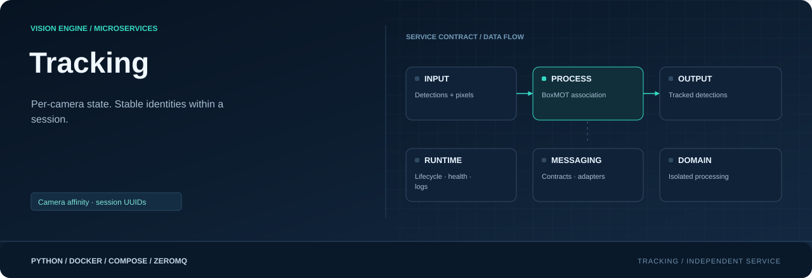

<div align="center">



**Keep state per camera. Publish stable session track identities.**

[](requirements.txt)
[](Dockerfile)
[](#responsibility)

[Project](../../README.md) · [Services](../README.md) · [Configuration](../../config/README.md) · [Handbook](../../docs/README.md)

</div>

## Responsibility

| Property | Value |
|---|---|
| Instance scope | One per tracked camera |
| Input | Detections; pixels if needed |
| Output | Tracked detections.v1 |
| Image | `visionengine-tracking:local` |
| Generated file | `config/.generated/tracking.compose.yaml` |
| Entry point | `python -m services.tracking` |

## Per-camera state

Each camera owns BoxMOT association state and UUID namespace. ByteTrack uses
only detections. ReID/motion-compensation configurations can require original
frames; graph condition `tracking_requires_frame` adds them. No YOLO runs here.
The model's tracking choice selects its `boxmot_tracker.yaml` profile.

## Correlation and output

Pixel paths require camera/stream/sequence, timestamp and dimensions to match.
Oldest detections wait for the exact frame or expiry; unrelated pixels are never
substituted. Bounded caches retain originals longer than inference's live queue.
Graph queue policies must be supported drop-oldest/camera-order combinations.

Output is `detections.v1/<camera_id>`, topic + JSON, container 5558, host start 8000.
Confirmed objects carry class, confidence, pixel box and UUID `track_id`. Source
identity/model/inference metadata stays intact, with added timing/session data:

```json
{
  "tracking": {
    "algorithm": "bytetrack", "session_id": "tracker-session-uuid",
    "tracked_at_ns": 1792000000020000000, "tracking_ms": 1.3
  }
}
```

IDs remain stable within a tracking session but change across cameras/resets/
restarts. They do not identify the same person across cameras. Algorithms can
suppress tentative objects, smooth boxes or emit predictions; output count need
not equal input count. No annotated image or viewing protocol is published.

## Run and inspect

```console
python -m config.controller --generate
docker compose -f config/.generated/pipeline.compose.yaml up --build -d visionengine-tracking-service-entrance
docker compose -f config/.generated/pipeline.compose.yaml exec visionengine-tracking-service-entrance python -m services.tracking.tools.receiver --connect tcp://127.0.0.1:5558 --camera-id entrance --count 5 --format json
```

```console
python -m pip install -r services/tracking/requirements.txt
python -m services.tracking --camera-id entrance --input tcp://127.0.0.1:6000
```

Add `--frames-input` exactly when the configured tracker requires pixels.

## Long-running behavior

New camera streams, model-version/dimension changes and idle gaps over 30 seconds
reset state. Duplicate/out-of-order inputs and retired streams are fenced. Missing
source sequences are counted, not synthesized into updates. Tracker age parameters
operate on processed batches, so tune for actual inference FPS. ByteTrack removed
history is pruned while preserving next-update lost-track cleanup. Per-class mode
uses separate instances; UUID creation needs no growing raw-ID mapping table.

Queues enforce items/bytes/age. PUB/SUB is best effort. Health requires recent
completed batches, including empty ones. Native timeout can exit the process for
Docker recovery; an unhealthy flag alone does not restart it.

## Algorithms and hardware

BoxMOT is pinned to 19.0.0. The adapter handles its supported package/registry
layouts; unsupported non-default overrides fail explicitly. ReID needs local
weights and compatible PyTorch/TensorRT. Selectors include CPU, MPS and indexed
CUDA; `auto` follows a compatible inference selector or CPU. Reference Docker uses
CPU Torch; `BASE_IMAGE`, `TORCH_INDEX_URL`, `INSTALL_TORCH` and host device access
must match the board. GPU/exported paths require actual device qualification.

## Source map

| Location | Responsibility |
|---|---|
| [__main__.py](__main__.py) | Module entry point |
| [Dockerfile](Dockerfile) | Image layers, packaged code, entry point and healthcheck |
| [requirements.txt](requirements.txt) | Runtime dependencies |
| `messaging/` | Service-local wire contracts, validation and input/output adapters: [detections.py](messaging/detections.py), [frames.py](messaging/frames.py), [publisher.py](messaging/publisher.py), [subscriber.py](messaging/subscriber.py) |
| `processing/` | Domain logic, bounded work queues and worker state: [tracker.py](processing/tracker.py), [worker.py](processing/worker.py) |
| `runtime/` | Configuration, CLI lifecycle, logging and independent healthcheck: [configuration.py](runtime/configuration.py), [healthcheck.py](runtime/healthcheck.py), [logging.py](runtime/logging.py), [service.py](runtime/service.py) |
| `tools/` | Diagnostic receivers and inspection utilities: [receiver.py](tools/receiver.py) |

## Operating notes

Run commands from the repository root. Use IDs from your installation; examples
use camera `entrance`, model `people` and device `node-01`. Host ports can change
with generated instance order; the umbrella endpoint maps are authoritative.

[Update only this image](../../docs/UPDATES.md) · [Inspect connections](../../docs/OBSERVABILITY.md) · [Storage and recovery](../../docs/STORAGE.md)
